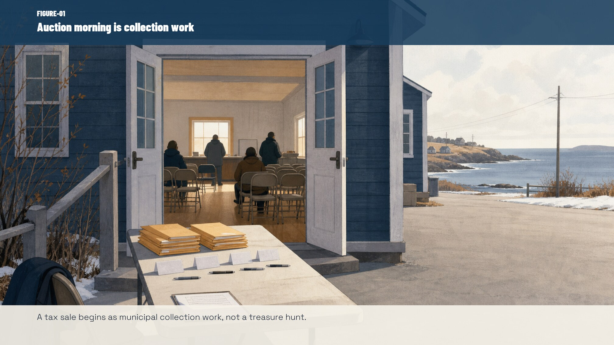
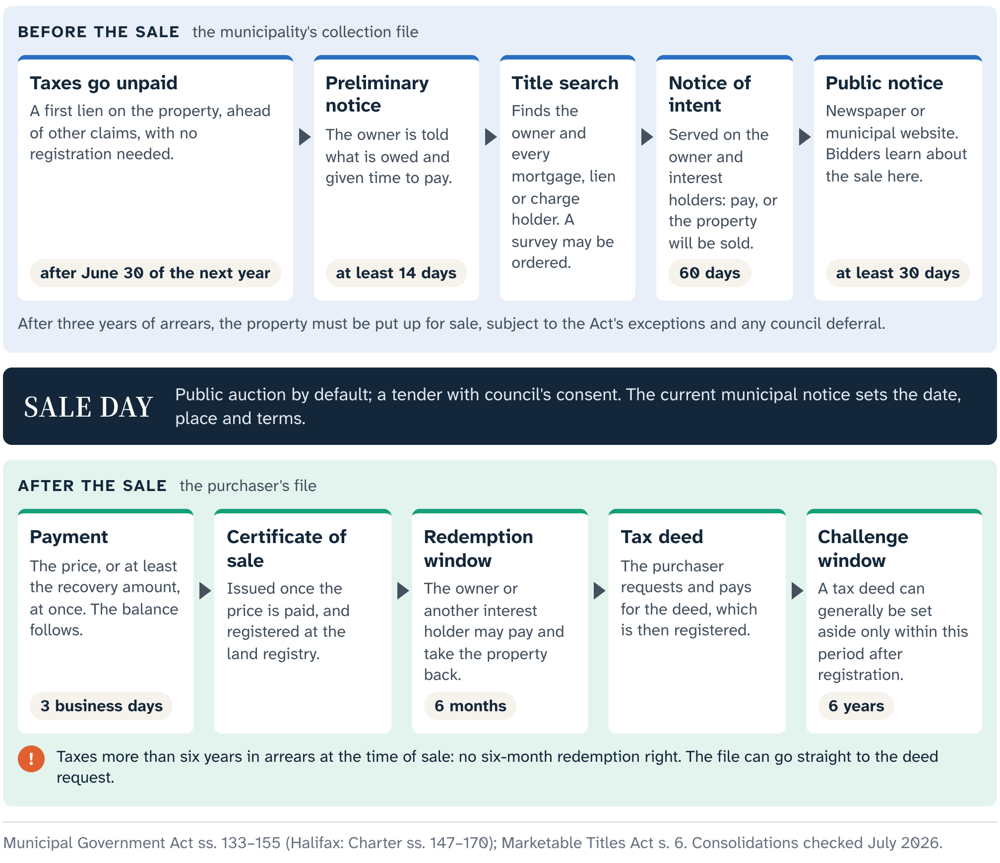
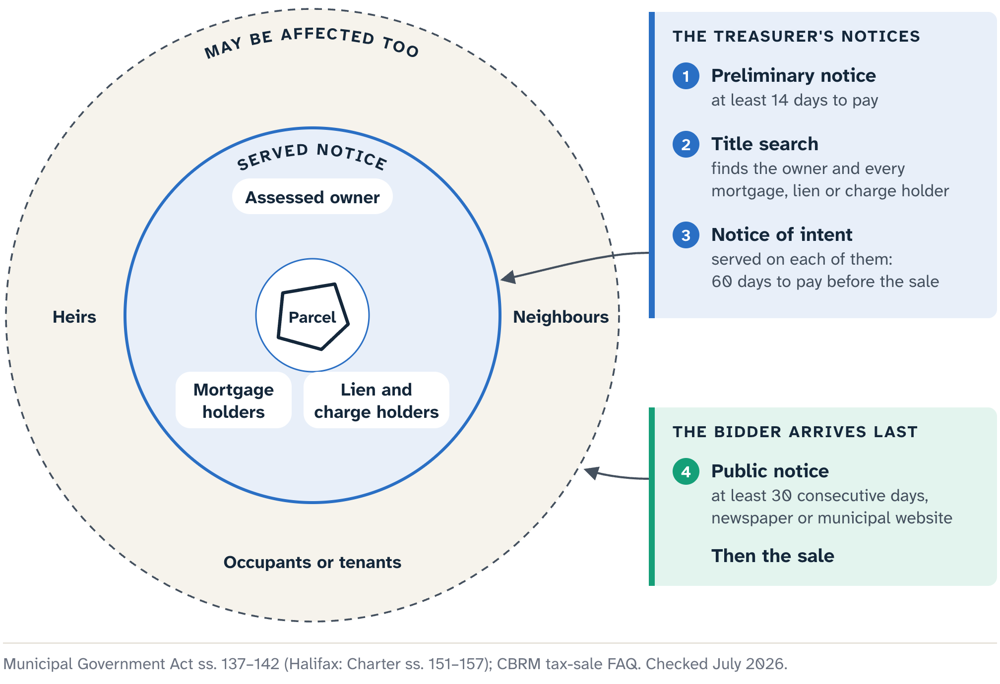
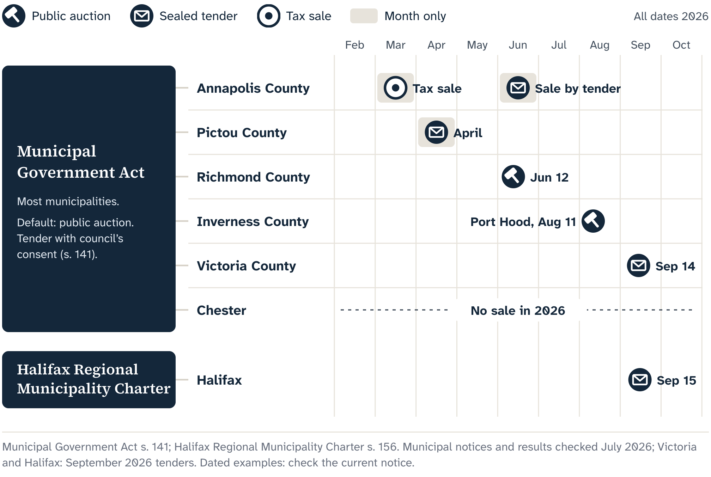

# The Last Scene First

Picture an August morning in a parish hall in Port Hood, a few minutes before a tax sale begins. The place comes from Inverness County's notice; the room itself is a composite. A municipal treasurer has a list. Registered bidders wait for the first parcel to be called. Outside the room are owners, lenders, heirs, neighbours and sometimes people living on the land, and each of them has a stake in the row that is about to be read out.

The auction is the part of a tax sale that people see. It is also the last scene of a much longer story.

Most people meet a Nova Scotia tax sale through an advertisement: a location, a parcel number, an amount owing. Inverness County gives readers far more than that. Its August 2026 packet is a substantial document. A typical entry combines the municipal account and parcel facts, an aerial image with the property outlined, a Property Online map and the legal description from the land registry. The packet also reminds readers that its map is for orientation and encourages them to research title.

That is good public work, and it saves a curious reader from starting with a blank page. It also invites a better question than "What can I add to this packet?" The better question is: **what does each part of this packet establish?**

## One parcel, many jobs

Take a fictional composite parcel we will call Harbour Road. It is not one of the live properties and has no owner attached to it.

The municipal page gives Harbour Road an account number and a parcel identifier. It places a shape over an aerial photograph, reports the assessment, quotes the registry description and may say whether a dwelling is listed. Each item is useful, and each comes from a different system with its own job:

- the parcel shape helps you find the land; a surveyor locates the boundary;
- the aerial photo shows what was visible on the day it was flown;
- the legal description is the registry's wording, which a lawyer reads for rights and access;
- the assessment is a taxation record;
- a "no dwelling listed" entry is a line in the assessment, worth checking against what is on the ground.

Maps make this easy to forget, because a coloured line around a piece of land looks like an answer. Treat it as an excellent starting point that tells you which records to pull next: the deed, the plans, the planning rules, a site visit from the road.

The Inverness packet also shows something useful about official records: they can disagree and still be worth using. Its first-page schedule lists **45 lien entries**. The detailed portion holds **44 property sheets**. Lien 6 appears in the summary with no matching sheet, and two recovery amounts differ between the summary and their detail pages.

Those differences are a question for the municipality. Careful research keeps both versions, names the two sources and asks the authority that runs the sale which one controls. Choosing the friendlier number because it makes the arithmetic work is the habit to avoid.

This is the first skill the book keeps returning to: **separate the record from the conclusion you want to draw from it.**

## A set of smaller questions

"Due diligence" can sound like one giant mystery. It is really a set of smaller questions, each with its own source and sometimes its own professional:

- Which legal interest is being sold?
- Which parcel does the identifier point to?
- Is there lawful access?
- What do the current planning rules allow?
- What is physically on the land, and is anyone living there?
- What can happen between a winning bid and a deed?
- Which answers can a public record give, and which need a lawyer, surveyor, planner, inspector or insurer?

The route through those questions is the same in every chapter: **notice, parcel, context, unknowns, handoff**. Later chapters carry the research file into a written bid decision, the sale, the certificate months and the deed. One fictional parcel can't show every branch (a redeemed file never becomes a deed file), so Harbour Road opens the method and a few other composite cases test it under different facts.

Throughout, the researcher organizes the questions and the bidder makes the decision.

That division matters because tax sales attract the language of hidden gems and bargains. That language turns a municipal collection process into a treasure hunt and pushes the people outside the room out of the story. A clearer account gives everyone their place. The municipality is collecting taxes under a legal process. Owners and interest holders keep their rights until the law says otherwise. A bidder takes on uncertainty in stages. A researcher improves the evidence and marks what is still open.

So we start by giving the Inverness packet full credit as a strong first source. The value of the next layer comes from four steps: reconcile the records, add lawful public research, mark what remains open, and route each open question to the right authority.

Before Harbour Road can be called, though, we need to go back to the beginning. Why is the municipality selling land at all?

## The first clock

The process starts with unpaid real-property taxes. The municipality is enforcing a debt, and that debt is attached to the land.

A **tax lien** is the municipality's legal claim against a property for unpaid tax. Under Nova Scotia's municipal statutes, it ranks ahead of other claims, liens and encumbrances, and it holds that priority without being registered. That is why the treasurer is in the room: the municipality is enforcing a charge created by law.

The lien starts a clock.

Outside Halifax, the Municipal Government Act lets a municipality begin proceedings for taxes unpaid from the immediately preceding taxation year, but not before June 30 of the following year. It also sets a backstop: subject to the Act's exceptions and a possible council deferral, a property must be put up for sale once taxes are unpaid for the three preceding fiscal years. Within that window a municipality may use a shorter trigger. Inverness and Chester, for example, describe accounts as eligible for sale after two years.

The provincial Act sets the outer frame, and each municipality describes how it works inside it. If Harbour Road sat in a different municipality, we would read that municipality's current process and notice.

## People before bidders

Before any sale, the municipality sends a **preliminary notice** giving at least fourteen days to pay. When that period ends, it runs a title search and may order a survey. The search identifies the owner and anyone whose mortgage, lien or charge gives them an interest in the property. Each of them then receives a further notice giving sixty days to pay before the sale.

That further document is the **notice of intent**: a formal warning that the municipality will sell if the amounts stay unpaid. At this point the owner and the interest holders are in the story, and no bidder has appeared yet. The file is organized around legal identity and process because its first audience is the people who can still pay.

Only then does the sale go public. A sale or tender must have at least thirty consecutive days of public notice, either in a newspaper in the way the statute requires or on the municipal website. The advertisement may describe the property briefly and send readers to the treasurer for the full description.

Imagine a municipal website posting this fictional line: "Harbour Road, parcel identifier ending 421, taxes and expenses owing." Its job is to identify a property in a collection process and tell the public where the full record is. It is a notice, written for the law's purposes. A map marker built from that notice does the same job: it takes you to the event and the apparent parcel.

## One law, many local events

The statute's default is a **public auction**. With council's consent, the treasurer may call for **tenders** instead, and council may set an acceptable minimum when a property might not recover all its taxes, interest and expenses.

Dated municipal examples show how much this varies. Inverness and Richmond have used open auctions. Pictou has used a sealed tender. Annapolis published results from a March tax sale and then from a June sale by tender. Chester said it would not hold a sale in 2026.

The provincial frame explains why a sale can happen. The municipality's current notice tells you whether this sale is happening, in what form and under which instructions.

Halifax works under its own law. Its tax sales follow the Halifax Regional Municipality Charter, a parallel framework to the tax-sale part of the Municipal Government Act. The sequence is similar; the authority is different. Halifax's administrative rules also make the hidden work in a file unusually visible, because they list the kinds of sale expenses a file can carry: notice, title search, survey, certificate and deed preparation, registration, closing and redemption administration. That list shows what the process involves. Each municipality sets its own charges.

::: {.rail label="Try it"}
The map shows two current events: an Inverness auction and a Halifax sale. You want to know how the Halifax sale will run. Which source controls: the Inverness packet, the provincial map marker, or Halifax's current notice?

**Answer:** Halifax's current notice, issued under its Charter. The Inverness packet shows what good municipal information looks like, and the map takes you to the right place; the notice for the event sets the rules for that event.
:::

We can now name the whole process. A **tax sale** is the statutory collection process through which a municipality offers a property once the required steps are complete. Its public face arrives only after a lien, the passage of time, record work and notices to people who may never set foot in the auction room.

Back in the Port Hood hall, the treasurer's list reads differently now. Each row is the far end of a municipal file and a legal clock. When the first parcel is called, the municipality is there to collect. What Harbour Road is worth, whether it suits anyone's plans and what remains uncertain after the hammer falls are questions for the bidder's own research, and that research is what the rest of this book is about.

::: source
- Municipal Government Act (Nova Scotia), consolidated to 9 April 2026: s. 133 (tax lien and priority), s. 134 (when proceedings may begin and the three-year sale threshold), ss. 137–140 (preliminary notice, title search, survey and notice before sale), s. 141 (auction or tender), s. 142 (public notice of at least thirty days).
- Halifax Regional Municipality Charter, consolidated to 1 May 2026: ss. 147–157 (the parallel Halifax tax-sale provisions); Halifax Administrative Order 18, Schedule 1 (tax-sale expense categories), snapshot July 2026.
- Municipality of the County of Inverness, tax sale property packet for 11 August 2026 (published 16 July 2026, retrieved 19 July 2026).
- Municipal practice examples as published by Inverness, Chester, Richmond, Pictou and Annapolis, checked 20 July 2026.
:::
