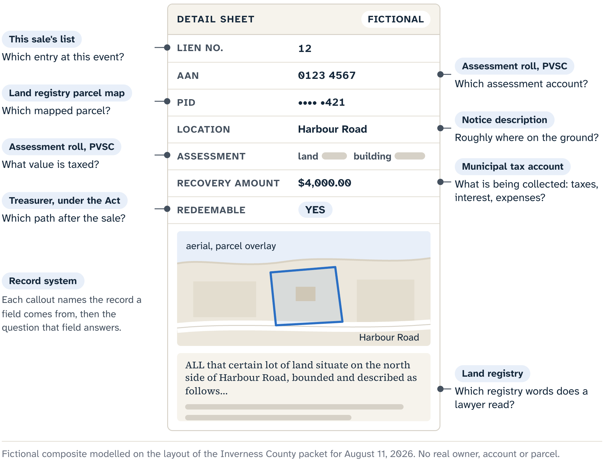
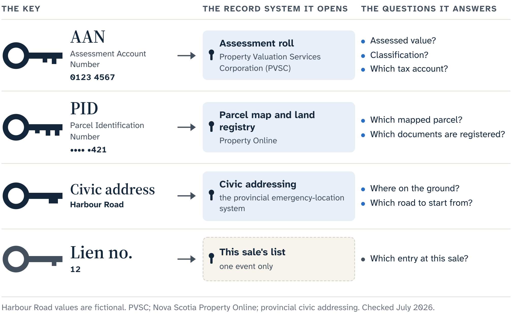
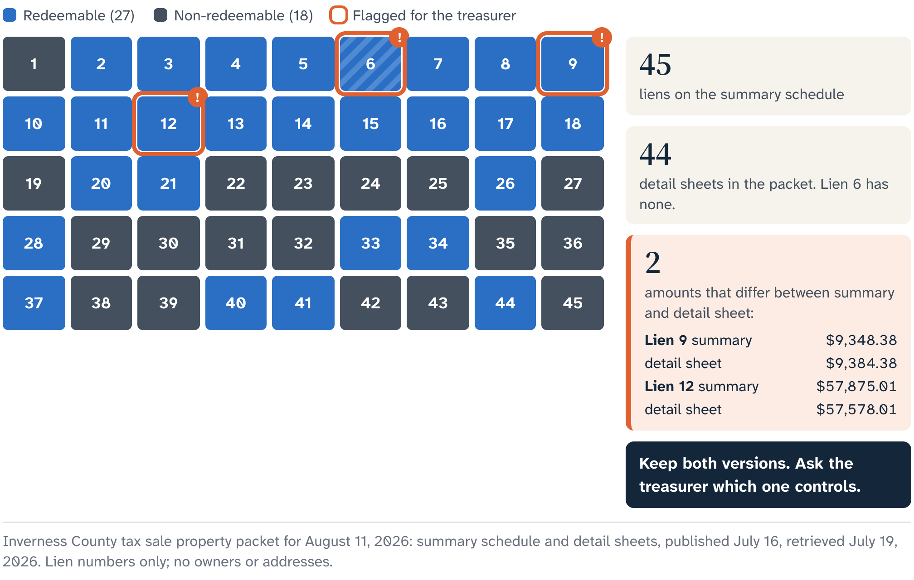
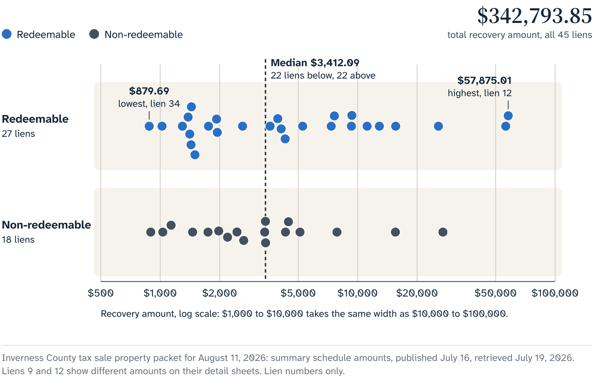

# Reading the Notice

The Inverness packet gives each property a compact row before its detailed sheet. The row looks like a summary of one thing. It is a bundle of references to several record systems.

Return to Harbour Road. Its row might hold a lien number, an assessed-owner field, an assessment account number, a parcel identification number and a location. Separate land and building entries, a recovery amount and a redemption marker may follow. You take it in at a glance and feel that the property has been described. What you have is a set of handles for starting research.

## Six fields, six jobs

The lien number is the municipality's label for the item in this sale. It lets the treasurer call the right entry, a bidder follow an amended list and everyone refer to the same row. Lien 6 in the August packet names a row in that sale only, and Halifax and Pictou number their own lists their own way.

The assessed-owner field belongs to the tax account. A notice may publish a name because the collection process has notice requirements and the account must be identifiable. Here the name is an account label, and the person behind it keeps their privacy. It can help a qualified researcher match the account to authorized land records. Occupancy, beneficial interests, an estate or relationship that complicates title, and the person's plans for the arrears are separate questions. Harbour Road stays owner-free, and the lesson about records loses nothing.

The **Assessment Account Number (AAN)** identifies the account in the property assessment and municipal taxation system. That account can carry assessed value, classification and other taxation information. Boundaries, road access, ownership quality and approved uses live in other records. A file that treats the AAN as a universal property number can stay internally consistent while following the wrong object.

The **Parcel Identification Number (PID)** identifies a mapped land parcel in Nova Scotia's land-information systems. When you ask "Which parcel do these records appear to concern?", the PID is the stronger starting handle. It leads to parcel mapping and registry information. A parcel is a unit in the land-record system. Its drawn shape serves orientation and record lookup, and a surveyor locates each boundary on the ground. Access, permitted use, physical condition and freedom from competing interests have records of their own.

Think of the two numbers as catalogue keys, one for the assessment account and one for the mapped parcel. The wrong key opens the wrong catalogue.

A row carrying one AAN and one PID is evidence that the municipality associated that account and that parcel with the entry it published. Whether each building, driveway, fence, utility line or apparent yard you picture belongs to that parcel is a separate question, with its own source.

The location field helps you orient. It may give a street address, or only a community, a road name or a general location. An address points toward a building or a civic point. The PID identifies the mapped parcel. The two can come apart. A building may sit near a parcel edge. A civic point may have been mapped for emergency response. A rural parcel may have no listing-style address. One entry may cover more than one parcel, or one apparent property may cross record boundaries invisible from the road. The address finds the area; the PID anchors the parcel question.

The land and building fields come from **assessment**: the valuation and classification record used to support property taxation. The Property Valuation Services Corporation makes assessments searchable by civic address and AAN. The land and building split shows how the system has represented the account, and a zero or blank building entry can be worth investigating. Treat it as a lead, never as proof of vacant land. A structure may have been omitted, changed, removed, damaged, newly built or linked differently in the records. The assessment's date and purpose matter.

The assessed figure feels authoritative because it is precise, but its precision serves taxation. An inspection answers condition, and an appraisal prepared for a current transaction answers value. A survey answers boundaries, registry research answers rights, and planning confirmation answers permitted use. Auction value and a safe bid come from your own work, later in this book.

Property Online links these handles. It is Nova Scotia's subscription system for ownership, parcel mapping and registry information. Searches by PID, owner, AAN and civic address make it a powerful professional tool. This book keeps its screens, plans, registry documents, names and extracts off the page, even though the author has lawful access. It says instead which identifier to use, which record may answer a question, and when a lawyer or surveyor should read the result.

## When the packet disagrees with itself

Chapter 1 noted that the real August 2026 Inverness packet disagrees with itself. Its summary lists 45 lien entries, and its detailed portion holds 44 property sheets. Lien 6 has no sheet in the downloaded packet, and two amounts differ between the summary and the detail page.

Keep both versions. For each source, record the lien number, AAN, PID, page and retrieval date it gives, and keep the awkward version beside the tidy one. The municipality owns the live sale process and can say which information controls.

Harbour Road's file can now hold a short source table:

- sale lien number: the event entry;
- AAN: the assessment account;
- PID: the mapped parcel handle;
- address or location: geographic orientation;
- land and building assessment fields: taxation records;
- municipal detail sheet: the municipality's expanded information for the dated event.

Read it as a routing sheet. Beside each field goes a question: who created it, what date it describes, what it can support, and which conclusion belongs to another source.

Routing pays off when fields disagree. Say the address points to one building and the PID map outlines a different shape. Picking the more plausible picture is the trap. Send the address question to civic and municipal sources and the parcel question to land records. Boundaries go to survey evidence; title goes to registry records and legal interpretation.

Harbour Road looks less simple now, and that is progress. The notice reads less like a real-estate listing and more like the first index card in a traceable research file.

## The fields that pull hardest

Two small fields tend to take over a notice: the advertised amount and the redemption marker.

The advertised amount looks like a price. Typography does the persuading: a parcel, a dollar figure and a sale date share one line, and the mind supplies an asking price. It may be far below ordinary real-estate numbers.

Its job is narrower. The amount is built around the taxes, interest and sale expenses the municipality seeks to recover through the process. When the packet uses the term, this book calls it the **recovery amount**, a name that states its purpose. Another municipality may say "minimum bid" or use another event-specific term, and its current notice controls.

::: careful
Under any label, the recovery amount is a collection figure for one dated event. It is set without inspecting the property or asking what an informed buyer would pay. Condition, title quality, legal access, repair costs, insurability, limits on future use, value and a safe bid all sit outside it.
:::

Say Harbour Road's recovery amount is $4,000. That supports one statement: "The municipality published $4,000 for this dated event under its stated terms." Deciding whether Harbour Road is worth more or less takes title, access, planning, condition, occupancy, tax, repair and uncertainty work. Objecting that the number looks small gets you no closer. Setting the assessment beside it only compares two administrative records, one from taxation and one from collection.

The real packet shows how widely these figures range from row to row.

The packet also shows why even an administrative number stays tied to its source. Where its summary and a detail page give different recovery amounts, keep both and ask the municipality which governs. Picking the lower one is wishful arithmetic. Picking the higher one because it feels safer is still an unsupported correction.

The redemption marker pulls the other way. "Redeemable" sounds like a feature of the parcel; it describes the legal path after the sale. Nova Scotia's municipal statutes normally provide a six-month redemption period. Within it, an owner or another person with a qualifying interest may redeem the property by paying the treasurer the amount the statute sets.

::: careful
The statutes remove that six-month right when the taxes were already more than six years in arrears at the time of sale. Municipal material may therefore mark such an entry as one that can move toward an immediate deed. Here "immediate deed" means a deed without the six-month redemption period. The marker does not settle possession, insurability, condition, clean title or permission to use the land.
:::

At the notice stage, the marker tells you which branch to prepare for. Chapter 3 follows both branches through the certificate, protective duties, repayment accounting and the deed request.

The August summary marks 27 entries redeemable and 18 non-redeemable. Those counts describe the packet on its publication date. Any entry may still drop out before the sale, or move between categories in a municipal update.

## A list that keeps moving

A tax-sale list stays fluid while collection continues. A listed parcel may be paid, redeemed, removed or deferred before or around the event. A municipality may publish a revision, and a sale may hold fewer rows than an earlier advertisement. You can research a parcel carefully and arrive to find its lien off the list.

That is the process working. The municipality's job is to collect under the statute, and a payment or a lawful removal means the notice helped do it. The hours you spent on the row give you no claim on the auction.

Here the living map enters the book's method. The checked build of NS Marks The Spot organizes current notices for the July 2026 Cape Breton Regional Municipality event and the August 2026 Inverness event. It filters by municipality, event and redemption category, and it can open a direct link to the official source. It is a dated catalogue that shortens the route back to the authority. The municipality decides whether a lien remains for sale. When a redemption category matters for a live decision, the source row, the current notice and qualified legal advice settle it, whatever the filter shows.

::: {.rail label="Try it"}
You saved the Inverness packet when it had 45 summary rows. On auction morning the map shows fewer entries, and you have a screenshot from several days earlier. Which count goes on your working list?

**Answer:** The municipality's current one. Open the map's direct municipal source, check the current notice or update, and ask the treasurer if the published sources still conflict. Record the retrieval time. The earlier packet stays in the file as accurate evidence of what was published then.
:::

## A file that survives a break

Test the file by interrupting it. You come back days later with a printed packet, a bookmark and notes that made sense when you wrote them. With its evidence and dates, the file should answer four plain questions without help from memory:

1. Which number identifies the mapped parcel? The PID.
2. Which number identifies the assessment account? The AAN.
3. Which source says whether the lien remains in the current event? The municipality's current notice, or direct confirmation from the authority running the sale.
4. What does a non-redeemable marker establish? The branch without the normal six-month statutory redemption right, because of the age of the arrears.

The test also catches a common versioning error. A file labelled "Inverness tax sale" can mix the original packet, a later update, a map snapshot and auction-day notes, all undated. Each source is authentic, and the combined file still misleads, because nobody can tell which rows existed when.

::: note
**Harbour Road's dated file.** "Packet retrieved July 20" describes one snapshot. "Municipal page checked August 10" describes a later state. "Treasurer confirmed withdrawn August 11" would describe an event-day fact, if that confirmation occurred. The dates preserve change: each document keeps its own moment.

The index card carries two dates: when the packet was retrieved and when the event status was last checked. Every amount and marker has a source beside it. A recovery amount without a page and date is a number detached from its authority. "Redeemable" without the current notice is a label detached from its branch.
:::

Read a withdrawal narrowly. It can mean the amount was paid or the row was otherwise removed or deferred under the process. Without an authoritative explanation, the public record may support only the status word and the date. A defect, an owner's win in a dispute or a municipal error stays a guess.

The map's historical-result mode answers a different question. A verified result documents the outcome recorded for a parcel at an earlier event. The current notice says whether a lien is active now. They are different record families, even when the same PID appears in both.

A withdrawn row was always part of a collection list. When it leaves, the collection process has changed before the event, and your file shows when and how the public record changed.

::: source
- Municipal Government Act (Nova Scotia), consolidated to 9 April 2026: ss. 141, 143 and 148 (taxes, interest and expenses recovered by a sale); ss. 152(1) and 155 (six-month redemption and the older-arrears exception). Halifax Regional Municipality Charter, consolidated to 1 May 2026: ss. 167(1) and 170.
- Nova Scotia Property Online page and user guide; Land Registration Administration Regulations; Deed Transfer Affidavit information (AAN and PID).
- Property Valuation Services Corporation, Find an Assessment, checked 20 July 2026; GeoNOVA mapping products.
- Municipality of the County of Inverness, tax sale property packet for 11 August 2026 (published 16 July 2026, retrieved 19 July 2026).
- Cape Breton Regional Municipality Tax Sales page, frequently asked questions and map disclaimer; Chester tax-sale process; both checked 20 July 2026.
- NS Marks The Spot production build, source commit d3114b5c, checked 20 July 2026.
:::
