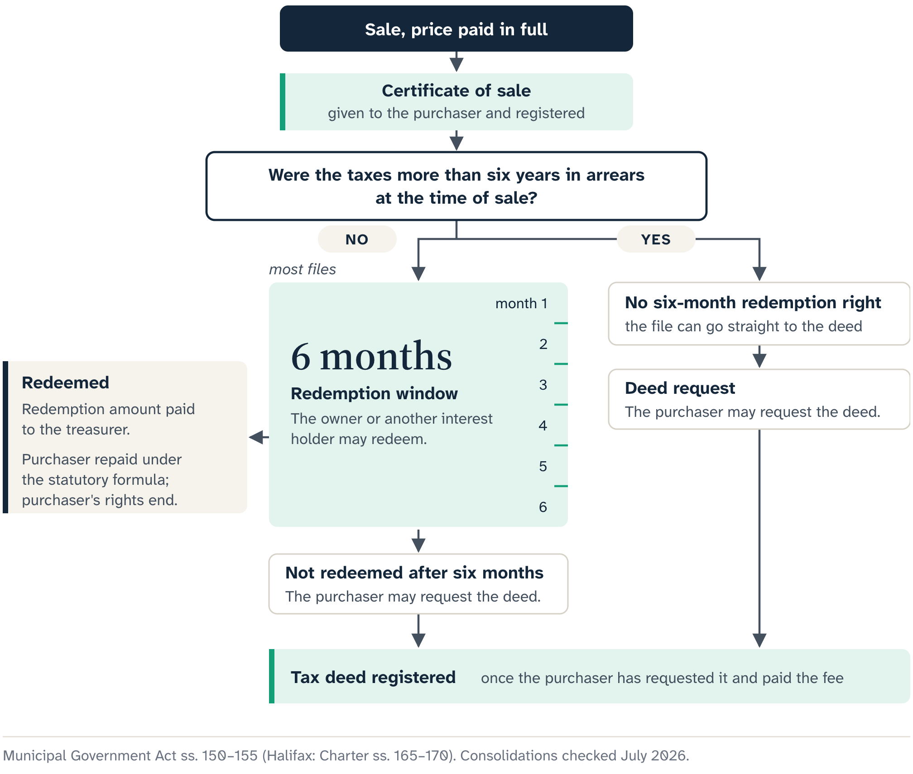
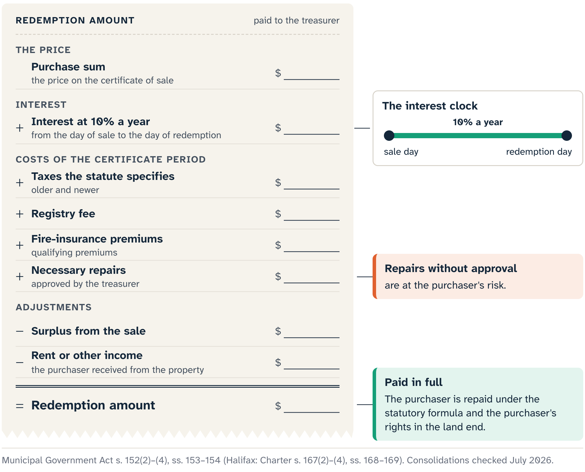

# The Six-Month Door

Back in the Port Hood hall, Harbour Road is called. A bidder raises a card, wins and pays what the sale terms require. The public scene feels finished. The legal position has just become more complicated.

For a redeemable property like Harbour Road, full payment produces a **certificate of sale**. The municipal treasurer prepares it, gives it to the purchaser and registers a copy in the land registry. The purchaser is now the **certificate holder**.

## The six months

The redemption marker from Chapter 2 now becomes a working mechanism. For most tax-sale properties, the owner or another person with a qualifying interest has six months after the sale to redeem.

::: careful
The six-month right has one large exception. When the taxes were already more than six years in arrears at the time of sale, the normal statutory redemption right does not apply. Those older-arrears properties follow the immediate-deed branch.
:::

Harbour Road is on the six-month branch, so the owner and other qualifying interest holders still have a live statutory route back to the property. That leaves the certificate holder in a middle state, with more responsibility than a prospective bidder and less finality than an owner with a deed.

## What a certificate holder may and must do

A certificate holder may protect the land, use it without diminishing its value, and collect rent. The holder must not injure the property or cut trees, and must insure any building that is insurable.

Each power has limits. Protection can support the work needed to keep an insurable building from deteriorating; a general renovation for the holder's preferred future use is another job. Using the land still answers to planning law, tenancy, occupancy, safety and the continuing redemption right. Rent collection raises questions for a lawyer: who occupies the premises, and how communication and accounting must lawfully happen.

::: careful
The duty to insure covers insurable buildings, and the statute cannot force an insurer to offer a policy for every vacant, damaged, occupied, remote or otherwise non-standard risk. Get a workable insurance answer before the sale. A bidder who wins without one may inherit the duty with no practical policy ready to meet it.
:::

## A leak in month two

In the second month, a storm damages the roof of Harbour Road's modest building, and water is coming in near an exterior wall. The certificate holder has to act. What work will prevent further damage? Who should authorize it? Which insurer must be told? What records will later prove what the work was and what it cost?

Protection is about preserving the property through a conditional period. It stops short of gutting the interior, clearing healthy trees for a view, changing the use or treating the building as vacant without evidence.

Keep a ledger from the first day. New tax bills, insurance premiums, necessary protective work, rent and other income can all matter if the owner redeems. Months later it may have to answer a treasurer or a lawyer, and money and authorizations rebuilt from bank statements and memory are unreliable.

The people outside the auction room are still on this clock. The owner may be arranging funds, and a lender or another interest holder may be weighing its position. An occupant may hear from someone who paid at a tax sale but holds no deed. A contractor may see the leak and wonder who can authorize which work. The treasurer runs the municipal process, and lawyers, insurers and other professionals answer the questions within their authority.

## Four questions before acting

Before acting, the certificate holder should be able to answer four stage questions:

- What document do I hold?
- Which power or duty supports the proposed action?
- Which continuing right or legal boundary limits it?
- What record will I need if the property is redeemed or goes to deed?

::: note
The leaking roof, run through the four questions:

The document is the registered certificate, and the action is protective work. The redemption right remains, along with any occupancy or tenancy obligations. The file needs insurer communication, professional advice where required, lawfully taken photographs, invoices, proof of payment and the municipality's approval where the statutory accounting calls for it.
:::

The questions are a stage check, with the legal tests left to a lawyer. They stop the broad word "owner" from hiding which document is in hand and which limits apply right now.

## When the owner redeems

In month four, with the building insured and protected and the necessary work documented, the owner produces the funds to redeem. The statute controls this branch, and the certificate holder's convenience is beside the point. What looked like an ownership project has become an accounting and discharge file.

The statutes set the redemption payment, and the holder claims within their categories. The payment starts with the purchase price plus interest at ten percent a year from the sale to the redemption. Then come specified costs from the certificate period: the taxes the statute lists, including later taxes and interest; the registry fee for the certificate of discharge; fire-insurance premiums; and necessary repairs the treasurer approved. Rent or other income from the property, and any surplus from the sale, reduce it. In a real redemption, the exact facts, dates, approvals and local administration matter.

The ledger matters more than the formula. Every claimed dollar needs a source, every repair a reason and the treasurer's approval, and every offset a record.

The roof shows why. An invoice proves a contractor was paid. Whether the work was necessary, whether it belongs in the calculation and whether it was approved are separate questions. The month-two file answers each one: the insurance file, photographs, a professional assessment, the municipality's correspondence and the proof of payment.

The same discipline runs both ways. Rent collected stays in the file, though it makes the repayment smaller. A cost that served the holder's own future project stays outside the qualifying items, even when it is called a repair. The statute sets the categories, whatever the labels say.

When the qualifying person pays the full redemption amount, the purchaser is repaid under the statutory process and loses rights in the land. A **discharge** of the certificate documents the ending, and the holder's control of Harbour Road ends with it.

That loss is easy to understate after months of protecting a building and picturing its future. The purchaser may receive the repayment the statute requires, but cannot refuse it and keep the land instead. Redemption is one of the outcomes built into the position bought at the sale. The owner and interest holders were in the legal story all along, even while absent from the Port Hood hall.

::: {.rail label="Try it"}
During the certificate months, Harbour Road's holder pays for two jobs: a roof repair the treasurer approved, and clearing healthy trees for a sea view. The owner then redeems. Which cost belongs in the redemption calculation?

**Answer:** The roof repair, because it was necessary, protective and approved. Clearing the trees breaks the rule against cutting trees, and work for the holder's own plans sits outside the statutory categories.
:::

## The deed branch

Now give Harbour Road a different ending: six months pass without redemption. Or take an older-arrears property, which skips the wait. Either way, the purchaser can move toward a **tax deed**: the municipality's deed, which the purchaser may request and pay a fee for once the applicable waiting period ends.

Under the municipal statutes, the tax deed vests fee-simple title free of encumbrances, subject to the statutes' treatment of continuing easements and rights-of-way. A lawyer reads those words against the actual parcel and its records. Keep them whole in any auction conversation; "clean title" is the shorthand to avoid.

Fee simple names a form of ownership. Every other question about the land keeps its own source. An inspection answers condition and a surveyor the boundary. Access comes from the registry, the plans and a lawyer; development approval comes from the planning authority. A lawyer advises on anyone living there, and an insurer decides cover. A tax deed can also be challenged for a set period after registration, as Chapter 12 explains.

"Immediate deed" describes timing only: the older-arrears category skips the normal six-month period, and the questions above still take their own time.

## Two parcels, one auction

::: note
Two parcels are called at the same auction. Harbour Road is marked redeemable. Quarry Lane, another fictional composite, is in the older-arrears category. Both purchasers pay in full.

Four months later, Harbour Road is redeemed and its certificate discharged. Quarry Lane's purchaser, with no six-month right to wait out, requests the deed and registers it. That deed is the ownership document for this stage. Whether the apparent driveway is a legal right-of-way, and whether someone lives in the building, are still questions for the registry and a lawyer.
:::

That is the redemption marker at work. "Redeemable" points toward a certificate period that may end in a discharge or a deed. "Non-redeemable" points toward the deed route without the six-month door.

The documents run in order: bid, payment, registered certificate, then a discharge or a deed. Each one has its own job and its own hazards, even when one purchaser holds them all.

Harbour Road leaves this chapter through a discharge, and its purchaser's rights have ended. Quarry Lane leaves through a registered deed, and its purchaser's ownership work has begun. Both endings point back to research that belongs before the bid, starting with the parcel biography in Chapter 4.

::: source
- Municipal Government Act (Nova Scotia), consolidated to 9 April 2026: s. 150 (certificate of sale), s. 151 (the certificate holder's powers and duties, including insurance), s. 152 (six-month redemption, the six-year arrears exception and the redemption amount), ss. 153–154 (repayment and the end of the purchaser's rights), ss. 155–156 (the tax deed and its effect).
- Halifax Regional Municipality Charter, consolidated to 1 May 2026: ss. 165–171 (the parallel Halifax provisions).
- Cape Breton Regional Municipality, Tax Sales page and FAQ (redeemable and non-redeemable categories; occupied properties), checked 20 July 2026.
- Intact Insurance, vacant-home and non-standard property pages, retrieved 19 July 2026.
:::
