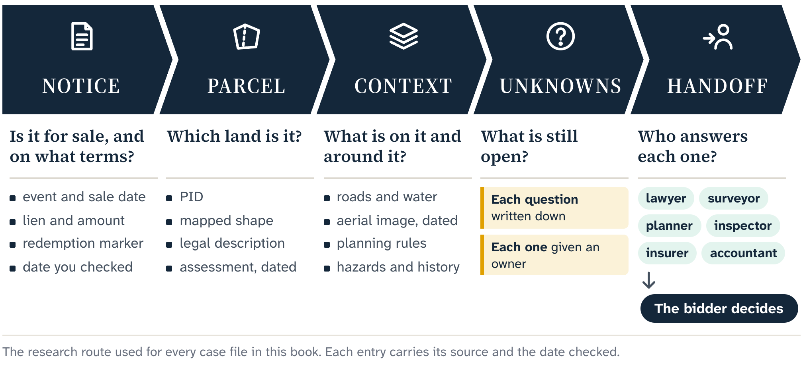
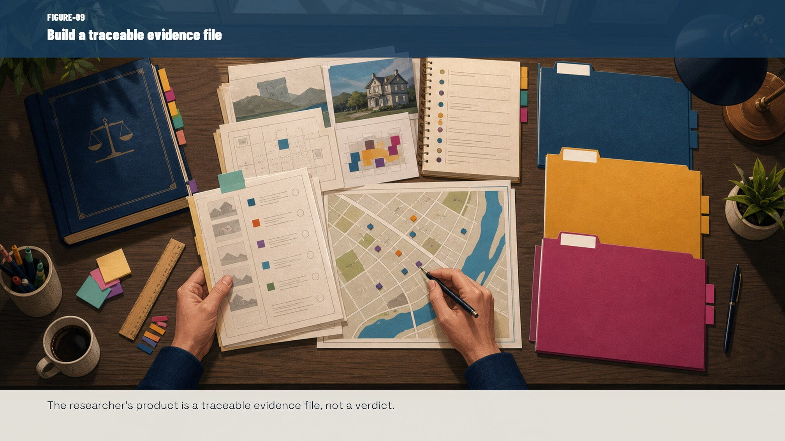
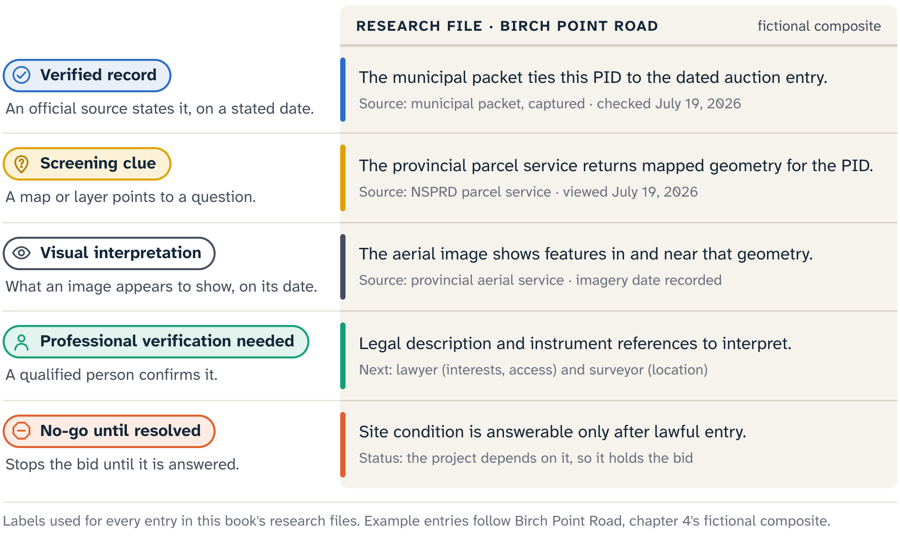
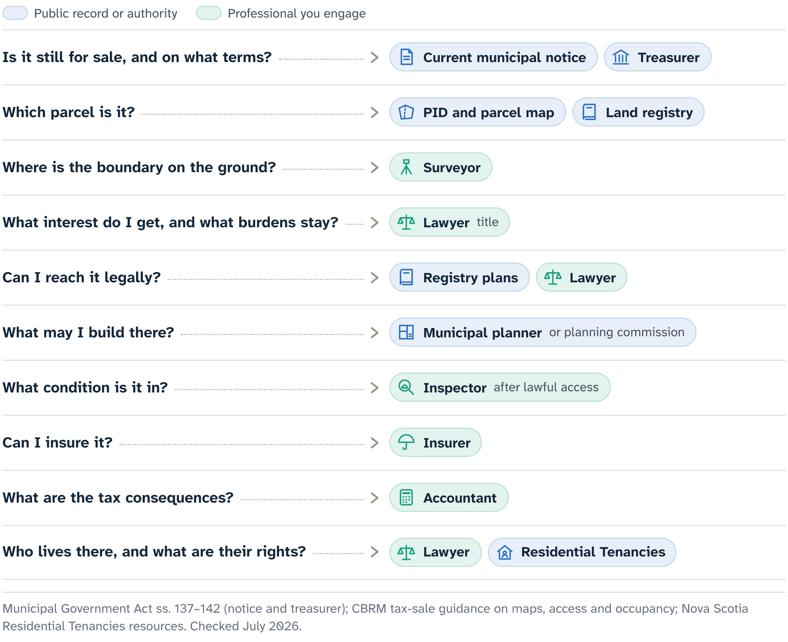

# Give the Parcel a Biography

Inverness County's August 2026 packet does more than a typical auction advertisement. Each detailed entry gathers account and parcel identifiers, assessment figures, mapped views and a legal description. Copying those fields onto a prettier page improves the look and adds nothing to what anyone knows.

Start with an inventory instead. Which facts came from the packet, and which source did the municipality name? Which details describe the auction event, which the assessment account, and which are offered as a description of the parcel? The inventory credits the municipality and keeps later research from passing as original discovery.

From there, the file follows the book's route: notice, parcel, context, unknowns, handoff.

## The source ledger

Take a fictional composite entry on Birch Point Road. Its packet row supplies a lien number, an Assessment Account Number (AAN), a Parcel Identification Number (PID), a civic location, assessment fields, a recovery amount and a redemption marker. The detailed page adds mapped orientation and descriptive material. Each field already has a job; the biography gives the collection a history.

The first page of the file is a source ledger. Each line records a source, a retrieval date and a limitation:

- event status and recovery amount: the municipality's dated notice;
- assessment fields: the account information reproduced in the packet;
- PID: a pointer to the provincial parcel and registry systems;
- mapped image: orientation;
- legal description: text that needs land-record interpretation.

The ledger earns its place when records disagree. In the Inverness packet, one summary lien has no matching detail sheet, and two recovery amounts differ between summary and detail. The biography keeps both versions with their dates and locations, and asks the municipality about the current event.

The biography starts with the PID, the stable parcel handle already in the file, and leaves the owner's name out. Owner-free, it still shows the whole method: exact PID, source, observation, limitation, open question, next authority.

Two routes open a biography on the NS Marks The Spot map. An exact PID selects the parcel returned for that identifier. An authoritative provincial civic-address result opens the parcel polygon that contains its point. Both save time; Chapter 5 works them in detail. Ownership, occupancy, legal access, the surveyed boundary and permission to enter remain questions for the records and professionals later in this chapter.

## Property Online and the parcel register

An authorized land-record researcher can use Property Online to connect the PID to provincial ownership, parcel-mapping and registry information. Searches by AAN, civic address or owner solve different matching problems. This book keeps that material off its pages: subscription access is for authorized research and carries no licence to republish subscriber screenshots, plans, registry documents, owner information or structured extracts.

In a lawyer's title review, the **parcel register** is the parcel-specific registry record within that material. It takes the file past the assessed-owner label on an auction notice to the documents and registered interests that need interpretation.

Keep three things apart. The search or register view is a dated snapshot. The source instrument, release, agreement or order holds the terms. The legal effect, including what the tax-deed provisions change and what they leave in place, needs the governing law and a reading specific to the property.

A mortgage, judgment, easement or other interest on the register is a lead, and the reviewing lawyer works out the rest: how it operates, whether another instrument changes it, its present amount, any release, its priority and its treatment after the sale.

Record the retrieval date and refresh the search near the decision. If a recent registration, pending document, court order or conflicting entry could matter, ask the land registration office or the reviewing lawyer what the current search might miss. A fresh result can change the question without answering it on its own.

## The legal description

A civic address helps people find a place. A **legal description** identifies land in the language of the conveyancing record. It may refer to bearings, distances, adjoining lands, plans, lots, roads, shorelines or older descriptions. Its job is to state what the instrument describes, for readers of the record more than for drivers.

On Birch Point Road, the civic location may bring you to the area, the PID may open a polygon on a public parcel map, and an aerial view may show a roof, a tree line, a road or a clearing. The legal description may refer to boundaries that are invisible in those pixels and unsafe to rebuild from them. The records support one another without standing in for each other.

A public parcel boundary is a screening exhibit: the shape reported by the current provincial service, good for orientation and for questions about apparent road or water relationships. A surveyor's evidence and the legal record answer where the boundary lies on the ground.

## Attribution travels with the image

Public views from NS Aerial and the Nova Scotia Property Records Database (NSPRD) carry a licence obligation. A rendered view from the covered Province services must keep the Province attribution: "Contains information obtained under license from the Province of Nova Scotia which is provided without warranty or liability for errors or omissions." The application must link to the licence. The attribution sits in the image, because a screenshot may travel beyond the app that made it.

The licence permits the checked public display, and this book makes no assumption that it covers redistributing raw geometry or a tile cache. Three questions stay separate: may the view be shown, where did it come from, and what does it prove? The licence and the attribution answer the first two.

## Title search

The last land-record term is **title search**: an examination of the chain of ownership and interests, well beyond a look at the latest name. Before a tax sale, the municipality does title work as part of the statutory notice process, to help identify the people entitled to notice.

::: careful
The municipality's title work moves a tax-enforcement process through its required stages. A bidder decides something else: whether the legal position, the uncertainty, the project and the price belong together. For that decision, a bidder may need a lawyer to examine the records. The questions overlap; the professional duty and the conclusion differ.
:::

## Words that report

Each record in Birch Point Road's ledger becomes an observation that stays within what its source did:

- The municipal packet associates this exact PID with this dated auction entry.
- The current provincial parcel service returns mapped geometry for the PID.
- The aerial service shows visible features within and near that reported geometry on its captured imagery.
- The land record contains a legal description and instrument references that need professional interpretation.

"Associates," "returns," "shows" and "contains" report what a source did. "Owns," "bounds," "permits" and "guarantees" are conclusions that wait for a qualified person.

Each observation also gets a label. In order, those four lines are a verified record, a screening clue, a visual interpretation and an entry that needs professional verification. The fifth label, no-go until resolved, marks a question that stops the bid.

## Four places an unknown can go

Labels grade each observation; sorting decides what happens next. Every entry goes to one of four places, gaps included, because a report that allows only confident sentences turns its gaps into assumptions.

The first place is verified. The dated notice associates an exact PID with an auction entry, and the file holds the source, the date and the captured record. "Verified" describes that match. Assessed value and classification are verified the same way, as account information matched to its source and date. Boundary, condition, title, legal access, market value and a maximum bid each go through the sort on their own.

The second is professionally verifiable. The parcel service shows geometry that appears to meet a road corridor, and the legal description refers to a plan. Whether that gives the frontage or right-of-way the intended use requires is a question for a surveyor, a lawyer and a planner. The label names a question, an evidence source and a competent route to an answer. That answer may remove the concern, define a manageable condition or end the project.

The third is priceable uncertainty. Suppose an insurer confirms that a vacant building can be covered only under specified terms and at a higher, known premium. That uncertainty can now enter a budget, as a quoted survey, a defined legal review or a known municipal application fee can. Priceable means a documented amount or a bounded range, with no invented number. A known cost can still make the parcel unworkable.

The fourth is no-go: a fact essential to the intended project that the researcher is unable to confirm before the sale. The answer may need entry, which the municipality has no power to authorize, or a study that needs more time than the sale allows. The evidence may stay contradictory, or the legal position may be too consequential to carry unresolved. The right label can then be "do not proceed under these conditions." It describes the fit between the evidence, the deadline, the researcher's tolerance and the proposed use. Another person with different expertise, authority, time or capacity for risk may decide differently.

::: {.rail label="Try it"}
You return to the Birch Point Road file after a week away. Which four questions put it back in order?

**Answer:** What does the file establish? Which named professional or source owns the next gap? Can a documented answer enter the budget? Is an essential gap still open and too large to carry? If so, stop before attachment rewrites the evidence.
:::

## Handing off the questions

The legal question can now be specific. "Is this property okay?" becomes four questions. Which registered interests affect the parcel? How should the legal description and the referenced plan be read? What would the tax deed do to those interests? What will still be open on sale day?

Take Birch Point Road's apparent road relationship. The lawyer gets more than a screenshot with "Looks accessible?" in the subject line: the file supplies the exact PID, the dated municipal record, the relevant instrument references, the legal description, the captured public view with its attribution, and the intended use. The question asks which registered rights provide legal access, and which interests or documents need review.

The surveyor gets a different question from the same file: what evidence would locate the relevant boundary or plan relationship, and can the work be done before the decision deadline? The tax-sale statute stays with the lawyer. The planner gets the proposed use, the current municipal source and the parcel identifiers, and names the planning, lot, frontage, servicing or permit questions that need confirmation. Title and physical condition stay with the lawyer and an inspector.

Each professional fee now buys a particular reduction in uncertainty, tied to a question whose answer can change the decision. That allows triage: a bidder may pay first for the question most likely to end the project, before ordering lower-priority work.

## When a court order is involved

Some legal routes sit outside an ordinary bidder's file. Nova Scotia's municipal statutes let a treasurer seek a court order on matters such as arrears, the interests conveyed, notice and the manner of sale. A sale under such an order has the protected effect described by the order and the statute. That mechanism belongs to the municipality, the court and the legal process.

::: careful
A bidder cannot assume a court order will repair an unclear current listing. If a notice or a legal professional points to a court-directed process, get the order itself, record what it says and take its effect to a lawyer. "Court ordered" and "risk free" are different statements.
:::

## A biography before a future

By the end of first review, Birch Point Road may sit in all four places.

::: note
**Birch Point Road after first review.** The exact PID-to-notice match is verified. A survey quote is priceable. The access question is professionally verifiable by the lawyer and the surveyor. An essential site-condition question has no lawful route to an answer before the sale, so it is labelled no-go for the proposed project.
:::

The no-go entry governs, however attractive the aerial image. Evidence is not a vote in which three comfortable facts outnumber one unresolved essential fact. How much an unknown matters depends on the project it can defeat.

That is the point of giving the parcel a biography before giving it a future. The file remembers where each statement came from, who can strengthen it, what it would cost to resolve and where the evidence has to stop. Emotional attachment arrives later, if it arrives at all.

Chapter 5 sets the biography in motion on the map: from a dated notice to an exact parcel, then one context question at a time, with every unknown and handoff kept in the file.

::: source
- Municipality of the County of Inverness, tax sale property packet for 11 August 2026 (published 16 July 2026, retrieved 19 July 2026).
- Nova Scotia Property Online page and user guide; Land Registration Administration Regulations.
- Municipal Government Act (Nova Scotia), consolidated to 9 April 2026: ss. 137–140 (title search and notice), s. 139A (court-directed sale), ss. 155–156 (tax deed); Halifax Regional Municipality Charter, consolidated to 1 May 2026: ss. 151–155 and 170–171.
- Province of Nova Scotia Restricted Geographic Services License, version 1.0.
- Property Valuation Services Corporation, Find an Assessment; Cape Breton Regional Municipality, Tax Sales page and FAQ; both checked July 2026.
- NS Marks The Spot, build d3114b5c, checked July 2026.
:::
