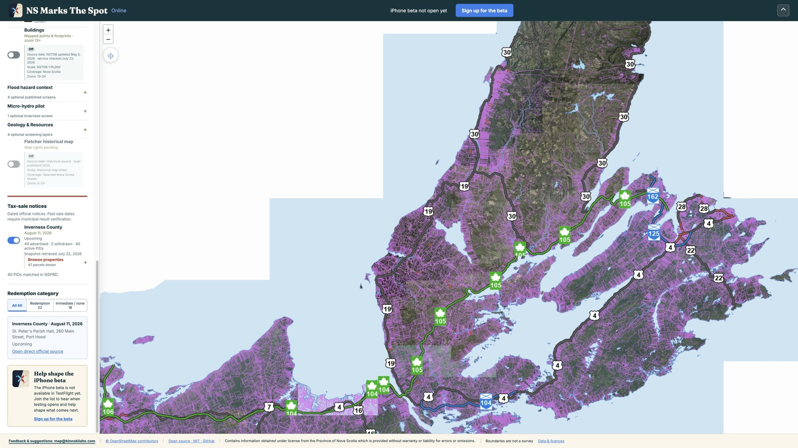
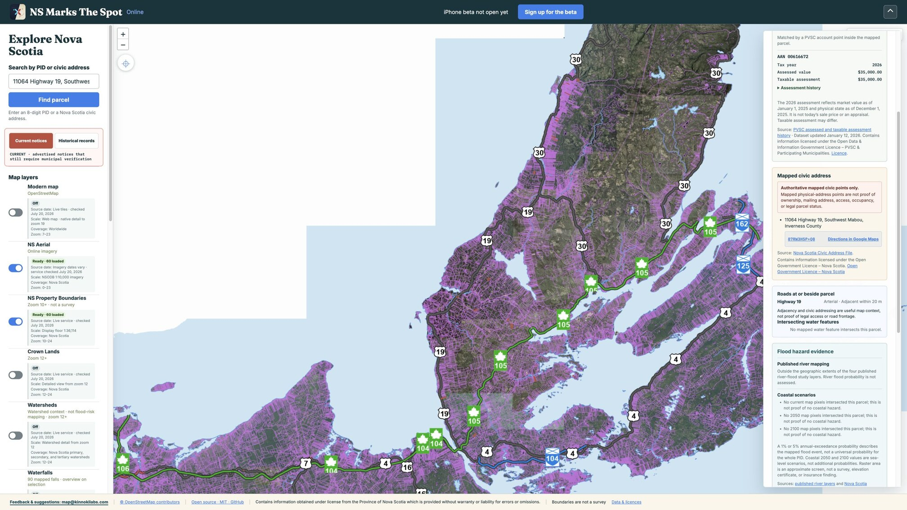
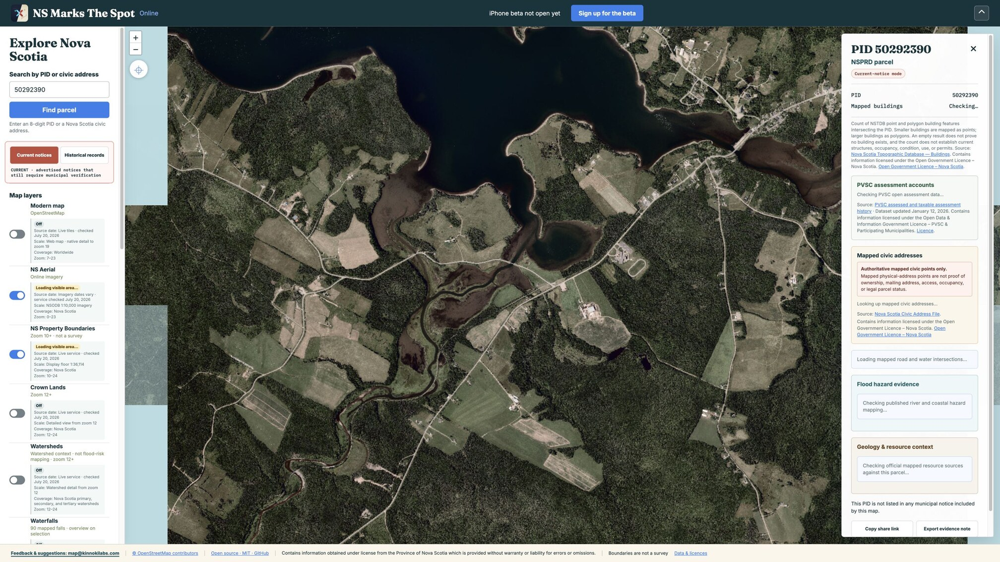
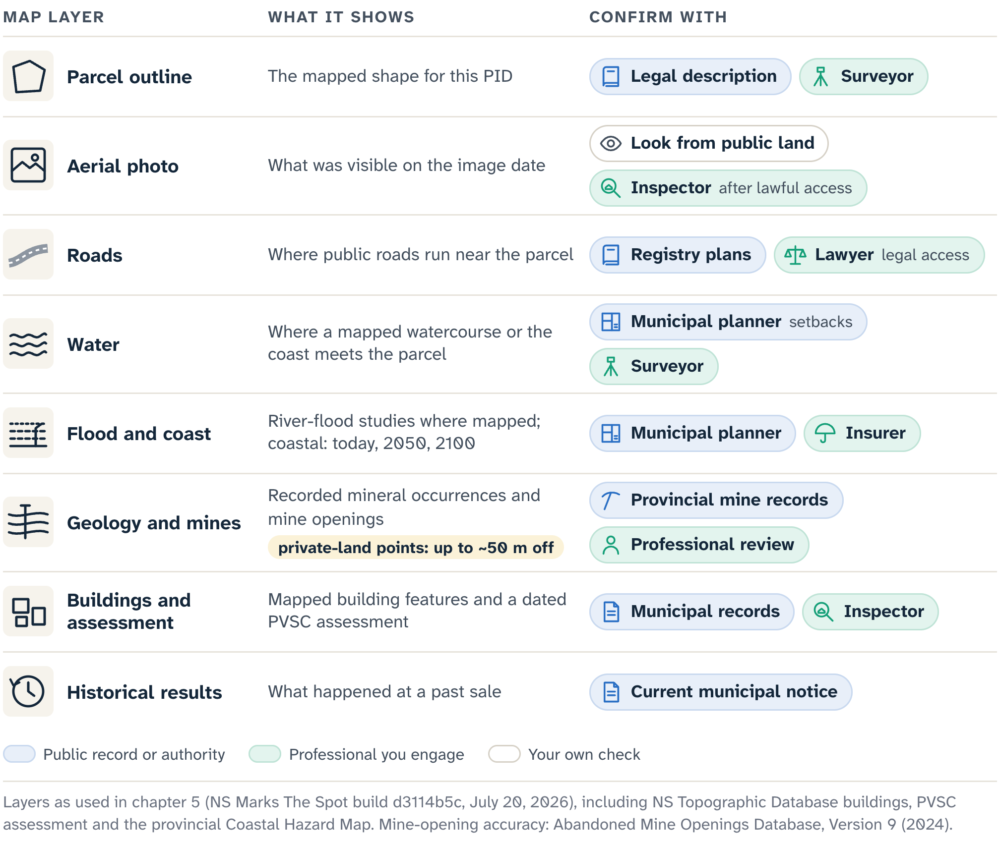
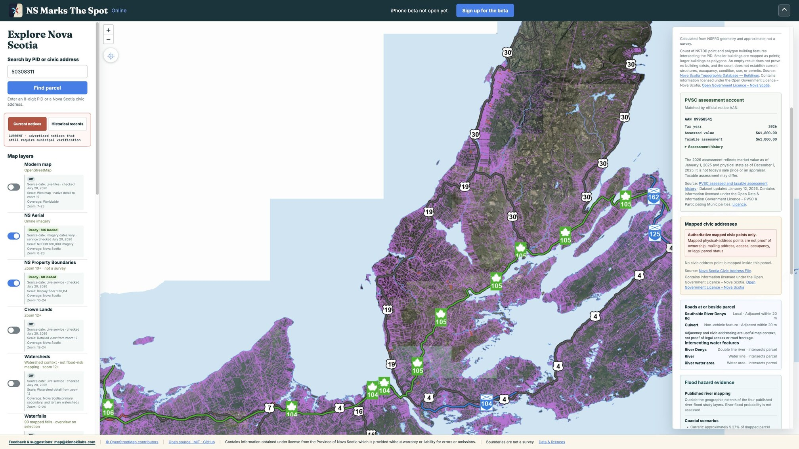
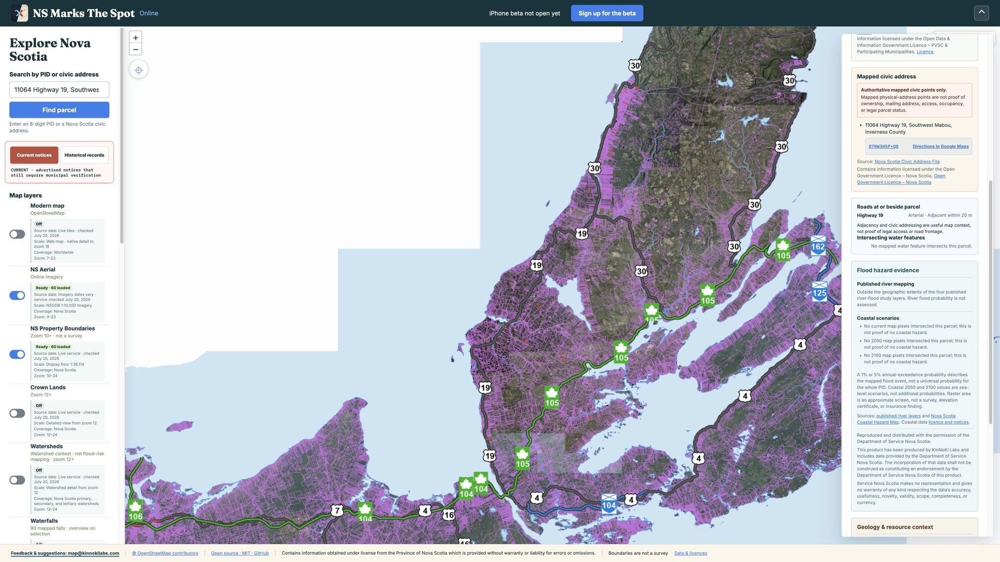
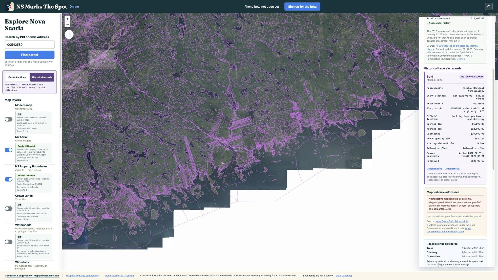

# The Map Is a Question Machine

NS Marks The Spot can show a tax-sale record, a parcel outline, a civic address, a road, a river and a geology symbol on one screen. That is its power and its main risk. The eye joins nearby marks faster than the mind checks their sources. Records made by different authorities, for different purposes, at different times start to feel like one property story.

The map works best when it slows that joining down and turns each mark into a question with a source, a date and someone who can answer it.

## Start with the record family

Choose the kind of record before you look at any parcel. The map keeps two catalogues, and they hold different kinds of evidence.

The current catalogue shows what a municipality presently says it intends to sell. In the production build checked on July 22, 2026, it listed Inverness County's August 11 event: 40 advertised records, 5 marked withdrawn and 40 active Parcel Identification Numbers (PIDs). That count is a snapshot dated that day.

The historical catalogue is off by default. It reports what checked sources established after earlier events, and it can hold a recent event whose outcome stays marked unknown while official results are pending.

In current mode, choose Inverness. The app shows the event date, the municipal source, the snapshot wording, the parcel list and each entry's published redemption category. The most important control is the direct source link back to the municipality that owns the record.

The app is a research index. The municipality's current notice, or its staff, says whether the sale is on, a parcel is still listed, the event is postponed or a term has changed. PDFs, screenshots, browser tabs and the map's own catalogue go stale, so open the link every time.

Suppose Birch Point Road, from Chapter 4, appears in the Inverness list. Confirm in the notice that the event, the exact lien, the PID and the status still match your file. If the notice and the app disagree, record the disagreement. The notice controls.

This book follows the same rule. Its production record names the map build, capture date and interface checks behind each figure. The site, the municipal pages and the provincial services can change or go offline later, and that record makes the change detectable.

## Pin down the parcel

If the notice gives an exact PID, search it. The map selects the parcel the provincial service returns and opens its evidence sheet: the PID, an approximate mapped area, the matching current notice, mapped civic addresses and context from other services.

The approximate area is calculated from the current parcel geometry and is good for orientation and comparison. Surveyed area comes from a surveyor and deeded acreage from the legal description; the interests involved come from the notice and a lawyer's title review. Keep the word "mapped" with the number.

The sheet may also count mapped buildings and show a dated assessment from the Property Valuation Services Corporation (PVSC). For PID 50292390, a demonstration parcel, the building query returned two Nova Scotia Topographic Database features, points or polygons, intersecting the mapped parcel. That count describes the map; a site visit, an inspection and municipal records describe the structures, with their occupancy, condition, use and permits. A zero would mean only that the query found no mapped feature, which is different from an empty parcel.

The same parcel matched PVSC Assessment Account Number (AAN) 00616672, with 2026 assessed and taxable values of $35,000. The sheet gives the valuation and physical-state dates and links the source. That is a dated taxation record; sale price, appraisal, repair cost and bid ceiling need their own evidence. The parcel appears in none of the map's current notices and is here only to show two fields with different limits.

A search can also start from a civic address. The map queries the provincial civic-address service, takes the authoritative **civic point** it returns (the mapped location of that address) and opens the parcel polygon that contains it. Nearest-parcel guesses and estimated addresses play no part. Containment tells you which parcel to investigate. Ownership, occupancy, mailing addresses, buildings, public entry and legal access stay separate questions, however obvious a nearby roof or road symbol makes them look.

The sheet also gives a **Plus Code** for each civic point: a short code for sharing or recovering a location without a street address. It is handy in rural areas where addresses are awkward or absent. When you send one to a surveyor or inspector, say what the point represents and how you got it.

If you come back to the file hours later, recover four answers before turning imagery and context back on:

- Current or historical mode?
- Which municipality and dated event?
- Did the direct source still confirm the entry?
- Exact PID, or authoritative civic-point containment?

Identity comes from the records; the pictures come second.

## The line and the picture

The parcel boundary and the aerial image together make a parcel feel physically known. Both are dated services. The line is graphical boundary information, and a surveyor locates the boundary on the ground.

Read them source by source. The current Nova Scotia Property Records Database (NSPRD) service returned this polygon for this PID. The aerial service showed these features on its imagery date. The Province's attribution and licence link stay on the view. Together they raise questions about how the parcel appears to sit among roads, buildings and water. Current condition calls for a look from public land and later a lawful inspection, and entry needs permission from someone entitled to give it.

With the parcel pinned down and its unknowns in view, the context questions can start.

## One layer, one question

A **layer** shows one category of mapped information. Roads, water, bedrock geology, mineral occurrences, mineral tenure and abandoned mine openings each come from a different service, with its own date, coverage, geometry and purpose. Several layers at once blur which source made which mark, so ask one question at a time and name the source first. Does the current road service report a line crossing the parcel? Does the mine-opening service return a point inside or near it?

The July 20, 2026 production capture for PID 50308311 shows the rhythm. It is a real current-notice PID, used only to test the interface, with no recommendation or evaluation attached. The location is Southside River Denys Road, Valley Mills, with about 5.12 mapped acres. Transportation is visible nearby, and the road query reports no mapped road or trail intersection. The water query returns River Denys features intersecting the parcel.

The water result is a **mapped intersection**: according to the query, the service's geometry for a named feature crosses or overlaps the parcel polygon. That is stronger than a line that looks close, and narrower than a finding that the real river crosses the legal parcel exactly as drawn. Wetlands, flood risk, the surveyed watercourse boundary, setbacks and ground condition are the next questions, for the flood screen, a surveyor, the planner and environmental sources.

::: careful
"No mapped intersection" with a road does not mean no access, and a road nearby does not mean legal access. A right-of-way can exist outside the road dataset, and a visible route can be private, unmapped, misaligned or legally irrelevant. Legal access, a recognized right to the passage you need, comes from the deed, the plans, a survey, the municipal road records and a lawyer. Chapter 6 tests it under pressure.
:::

A six-part note keeps the result in proportion. Leave out the limitation and the result sounds too strong. Leave out the observation and the note becomes a generic disclaimer. Leave out the unknown and the handoff, and you have caution without progress.

::: note
**River Denys: six-part map note.**

- Source: current provincial road and water services, checked production build.
- Date: July 20, 2026 capture.
- Observation: River Denys water intersections; no mapped road or trail intersection; transportation visible nearby.
- Limitation: source and parcel geometry are both screening data.
- Unknown: legal access, ground conditions, water constraints, service completeness.
- Next authority: land records and a lawyer for access; a survey and current municipal or environmental sources for physical and regulatory questions.
:::

## Flood studies and coastal scenarios

Flood evidence starts with coverage. The evidence sheet keeps published river-flood studies apart from the current, 2050 and 2100 coastal scenarios. A one-percent or five-percent annual-exceedance probability describes the event a particular study mapped, not a flood probability for every point in the PID. The coastal years are sea-level scenarios, separate from those probabilities.

For PID 50292390, the checked screen placed the parcel outside the geographic extents of all four published river-study layers and found no intersecting pixels in the three coastal scenarios. Neither result proves there is no flood hazard: outside study coverage means the river question was not assessed, and an empty raster intersection is an approximate screen. A survey, an elevation certificate, a site-specific analysis and an insurer answer the flood question for a parcel; a planner says what the mapping means for building there.

## Geology and resources

The same rhythm applies to bedrock geology, mineral occurrences, mineral tenure and abandoned mine openings, layers that can reveal a history an aerial photo keeps hidden. Set aside "Is this mineral land?" and ask about the service. Does it return an occurrence or opening within the parcel or a defined screening distance? What does the dataset represent, as of what date and with what coverage? Which provincial record explains the feature?

An occurrence marks where something was recorded. Reserves, mineral rights, economic potential, contamination and danger are separate questions. The mine-opening inventory calls itself incomplete: it leaves out surface signs of subsidence, and its 2024 metadata says private-land positions can be off by up to approximately 50 metres. Underground workings and site condition need other records. Tenure geometry shows where tenure is mapped; what can happen on the surface depends on the governing records and the law.

An empty view means the current query returned no displayed feature under the current settings and service response. It does not prove that nothing is there, that the site is clean or that the service is complete. That is why the map shows loading, empty and error as separate states.

The handoff follows the result. A geology record goes to a geoscience source or qualified professional, and a tenure question to the authoritative registry and legal interpretation. A mine opening or site-condition question needs current records, a lawful inspection and an environmental or engineering professional. The map gives the question an address.

## A small find, and a larger property question

Around 2015, I used a provincial mineral-occurrence record to choose a brook for recreational gold panning. The record made no promise of gold; it gave me a reason to look. I bought a pan, tried the brook and found a little colour. It was a long way from paying the bills, but it showed what a public geological record can do. The brook stays unnamed, because its location is beside the point.

On a property file, the same observation goes in the questions column, as neither a bonus nor a reason to reject the parcel. Gold nearby may interest a recreational panner and still raise questions about mineral tenure, surface access and future land use. Who may explore? Could mining pay? What could happen on a particular surface parcel?

Nova Scotia law makes the point concrete. The Crown owns the minerals. A mineral-right holder or prospector who cannot obtain the owner's or occupier's consent may apply to the Minister for surface-access rights. A mineral lessee who cannot acquire land, or an interest, needed for a mine or for a purpose connected with or incidental to one may apply for a vesting order. Once the order is filed, the vested land or interest is deemed expropriated.

The power has been used. In 2012 the Province granted DDV Gold vesting orders for fourteen parcels needed for the proposed Touquoy mine, after acquisition agreements could not be reached. The Supreme Court of Canada later refused leave in Forrest Higgins's challenge involving part of his family's tree farm. Touquoy did go on to produce gold. The wider lesson: the Act can reach land needed for purposes connected with a mine, beyond the spot where the ore comes out.

So ask which occurrence was returned, what tenure exists, which surface rights may be involved and what the current law permits, and file the answers under unknowns and handoff. The map still does what the pan did years ago: it shows where a worthwhile question begins.

## Historical mode

Historical mode asks for a different restraint. Its dated catalogue filters by municipality, year and recorded outcome, labels each record historical, and links to the official notice and, where one exists, the official result.

A captured Halifax example, PID 00542589 from the March 8, 2022 event, shows the recorded opening and winning amounts with derived difference and ratio fields. They answer one bounded question: what did the checked official records report for that PID at that event?

::: careful
A historical result is not a present value, a comparable sale, a forecast of competition at another auction or a bidding ratio. Each outcome happened under its own legal, physical, market, information and participation conditions. The official sources stay attached so the record can be audited.
:::

A newer Cape Breton Regional Municipality (CBRM) record shows the opposite case. PID 15234636 appears in the July 21, 2026 event with its minimum bid and notice fields, and its winning-bid field reads "Awaiting official results." The event page says results will be posted after payment is confirmed. So the record is a notice waiting for its result: the outcome, the purchaser and the parcel's present ownership and status stay unknown until the municipality publishes. Moving into historical mode after the event date changes the label, and the result still comes from the municipality.

Results still teach that advertised properties may be removed, that opening and winning amounts can differ and that outcomes vary. That is a lesson about process and evidence.

When you return to a session that showed both a current parcel and a historical result, name the record family before you repeat any amount: "a historical Halifax result from March 8, 2022," or "a current Inverness notice snapshot for August 11, 2026."

::: {.rail label="Try it"}
A parcel sheet shows an opening amount and a winning amount. What do you confirm before those numbers go into your file?

**Answer:** Whether the record is current or historical, and its municipality and event date. A historical amount describes that event; the current notice and your own evidence describe the parcel today.
:::

## The method in five words

Each step above is one of the book's five words at work: notice, parcel, context, unknowns, handoff.

Birch Point Road's file now ends in questions, each with an owner, and no score.

::: note
**Birch Point Road: map entry.** Current-mode Inverness entry confirmed with the municipality on the recorded date. Exact PID selected; mapped geometry and approximate mapped area returned. One contained civic point, with a Plus Code. Boundary, aerial, road, water and resource context from named public services on the stated date: attributed screening observations. Questions raised: access (road), source and ground condition (water), records (resources). Open: survey, title, access, occupancy, entry, environment, resource value, condition, development. Next: land records, legal review and survey for registered access; current authoritative sources and qualified professionals for water, geology and site condition, before deciding whether the project can proceed.
:::

A note that said "found it" would have hidden which thing was found. The event record, the parcel geometry, the civic point and the visible site are four separate findings. The screen has become more useful as the list of explicit unknowns has grown. That is success: a research tool earns trust by showing where knowledge ends.

The map has shortened the route from public notice to precise questions. It has left each authority and professional in charge of its own answers, and made one parcel easier to investigate and harder to romanticize. That is the job of a question machine.

::: source
- NS Marks The Spot production map, source commit d3114b5c: deployment receipt retrieved 20 July 2026; captures of 20 July 2026; Inverness catalogue snapshot of 22 July 2026.
- Province of Nova Scotia Restricted Geographic Services License, version 1.0, for the NS Aerial and NSPRD services shown. Required attribution: "Contains information obtained under license from the Province of Nova Scotia which is provided without warranty or liability for errors or omissions."
- GeoNOVA parcel mapping; Municipal Government Act (Nova Scotia), consolidated to 9 April 2026, s. 139 (survey before sale).
- Provincial civic-address service; Nova Scotia Topographic Database buildings; PVSC assessment history.
- Published river-flood study layers; Nova Scotia Coastal Hazard Map and user guide, refreshed 20 July 2026.
- Nova Scotia Abandoned Mine Openings Database, DP ME 10, Version 9 metadata (2024).
- Mineral Resources Act (Nova Scotia), consolidated to 9 April 2026: s. 5, ss. 25–26 and s. 27.
- Touquoy: Government of Nova Scotia release, 15 June 2012; Supreme Court of Canada Bulletin of Proceedings, 28 February 2014, file 35540; Information Circular ME 84 (2024).
- Inverness County notice for 11 August 2026; CBRM event of 21 July 2026; Halifax notice and result for 8 March 2022.
:::
