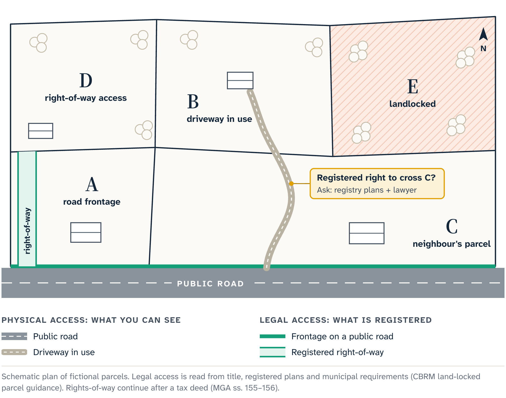
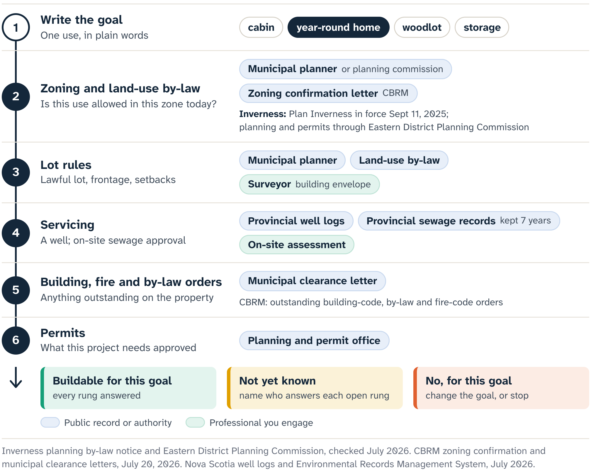

# Access and Use

Maple Ridge is a fictional composite, and from a kitchen table it looks easy.

::: note
**The Maple Ridge file.** A long, narrow sliver just behind two roadside lots. On the aerial image, a pale track leaves the public road, crosses one of those lots and seems to continue into the sliver: a beginning, a middle and an apparent destination. The auction recovery amount is modest. The bidder's goal is a small year-round house.
:::

That image can carry a researcher farther than the evidence goes.

Chapter 5 kept an empty road search from turning into "landlocked", and a nearby line from turning into "accessible". Maple Ridge is a harder test. Tire marks appear to join the road, and the parcel polygon seems to meet the track at its far end. You could point at the screen and give directions.

The question that matters is a legal one: does whoever acquires an interest in the sliver have a legally supportable right to use that route for the intended purpose?

## The route you can see

At the road edge, the track is a physical opening. A neighbour, a former owner or a forestry crew may have used it, or no one for years. The mapped parcel line may sit slightly off the feature on the ground, and the route may cross someone else's land. A gate, washout, seasonal condition or disagreement may be newer than the image or too small for it to show.

A tax-sale listing gives no right of entry, so before the sale you research from the public road or from land where you have permission. The Cape Breton Regional Municipality (CBRM), this book's operational comparison, says it does not provide access to listed properties. Other events set their own current terms.

The title and plan research asks whether the sliver benefits from a registered interest or other legally supportable route over the land in between: where that route lies, what it permits, and what conditions or obligations come with it. A lawyer reads the records for their legal effect. A surveyor relates the described boundaries and routes to the ground. The municipality or road authority answers its own road-status and development questions.

A **right-of-way** is a right of passage over land, and its terms decide what it does. Its source matters, and so do the land it benefits and the land it burdens. Its description, route, permitted users, purposes, width, maintenance terms and conditions may matter too. A route good enough for occasional foot traffic may fall short for vehicles, construction traffic, utilities, emergency response or year-round residential use.

Think of the visible track as a door. Evidence of a sufficient right-of-way or public-road relationship is the key that may authorize passage. A door can be obvious while the key is missing, and even a real right-of-way opens only what its terms describe.

The sale notice holds no key. It identifies the sale entry and points you to the exact parcel, and the public map orients you. A tax deed may later change the purchaser's registered interest, according to the governing process. It does not create a missing route across a neighbour's land.

Suppose the authorized record search finds an old plan showing the pale track. That helps, and it raises new questions. Was the line surveyed as a boundary, drawn as an existing road, proposed as a route, or tied to a registered interest? Does the current parcel benefit? Can the description be located? Has later work moved the route? The plan, related instruments, current survey evidence and legal interpretation have to be reconciled together, however convincing one picture looks.

Now change one fact: the owner of the front lot maintains the track, has it snowplowed and uses it every day.

::: careful
Steady use of the track does not establish that Maple Ridge has the right it needs. That right, if it exists, is a legal question, answered by a lawyer from the title instruments, the plans and the law. The people using the route may have permission, rights tied to different land, or a dispute the aerial image can't show. Long use can raise legal questions, and a lawyer answers them; local habit offers only a guess.
:::

The access note can stay short:

::: note
**Access note.** Current parcel and aerial services show a driveway-like route from the public road toward the selected graphical parcel, apparently crossing an intervening parcel. Still to establish: the legal boundary, road status, right to pass, physical condition and permission to enter. Next evidence: title instruments and plans interpreted for the exact parcel, survey advice where location is material, and confirmation from the responsible road and planning authorities for the intended use.
:::

The note is actionable without calling the route good or bad, and it sets a stop condition. If the project depends on vehicle, construction, utility or emergency access, the required right has to be supported before the bid decision. Otherwise the gap is a no-go uncertainty, however low the recovery amount.

Three findings now stand apart. Getting near the land is a physical observation. A right to reach it is a legal conclusion that needs support. A route that can serve the project is a further physical and regulatory question.

## The use the land must support

Now assume a lawyer finds a registered passage right that appears to benefit Maple Ridge, and a surveyor can relate its description to the ground. One threshold is crossed. Several remain.

The planning conversation starts from the intended use: a planner can test a named project, and a vague hope gives them nothing to test. The useful question names the exact Parcel Identification Number (PID), the proposed use, the access evidence so far and the confirmation needed before a bid.

**Zoning** is the system that assigns land-use categories and rules to places. A zone can list uses that are permitted, prohibited or subject to conditions, and point to standards that shape a project. The coloured zone or short code on a map opens the planning inquiry.

In Inverness County, the municipality-wide Plan Inverness Municipal Planning Strategy and Land Use By-law took effect on September 11, 2025, so the older assumption that rural land there is unzoned is out of date. The Eastern District Planning Commission administers planning and permitting services. Check the current rules and get parcel-specific guidance at the time of your decision.

A residential label is tempting to read as permission to build a house. It folds several questions into one word:

- Is the parcel a lawful lot for the proposed development?
- Does it meet frontage and access requirements?
- Which setbacks apply?
- Will the building and its supporting works fit?
- Which water, sewage, driveway, fire, building or other approvals are needed?
- Do site-specific constraints or other laws govern the same land?
- Which facts can the authority confirm now, and which need an application, a design or a professional submission?

CBRM sells two records checks that touch this list: a Zoning Confirmation Letter, which identifies current zoning and the applicable land-use by-law provisions, and a Municipal Clearance Letter, which reports outstanding building-code orders, by-law orders and fire-code violations. Inspection and project approval are separate steps.

**Road frontage** is the parcel's relationship to a road, as the applicable rules define and require it. Suppose Maple Ridge's polygon also appears to touch the public road at one corner. That sliver of on-screen contact is a lead for both questions: proving legal access there would take the description, survey and road evidence, and the frontage determination comes from the rules. A right to pass over a neighbour's land may solve one legal access problem and leave a separate frontage or development-standard problem.

Maple Ridge shows the difference. The registered passage may let vehicles reach the land while the rules still require the lot itself, or a proposed alteration to it, to meet a particular road relationship. The public road's status may matter too, and so may the route's width and physical capacity for emergency access or construction. The planning authority answers that rule question for the proposed project.

The bidder's call can therefore be specific:

> I am researching this PID for a small year-round dwelling. The parcel appears to lie behind roadside lots, and its access is still under legal and survey review. Which current zone and lot-status rules apply? What frontage, access, setback, service and permit questions must this use resolve? Which can your office confirm before purchase, and which require a later application or professional plan?

The call asks for confirmations the office can give, and it discloses the access gap.

Suppose the planner confirms that a dwelling is a permitted use in the zone. That supported fact removes one possible prohibition.

::: careful
A permitted use and an approved project belong to different stages. Whether this parcel is a buildable lot, whether a compliant building envelope exists, whether the route can serve a dwelling and whether water and sewage approvals will be available are all still open.
:::

Setbacks raise a similar problem. A narrow parcel may have enough mapped area in total and too little usable shape once road, side-yard, water, access or other requirements apply. A survey and the rules settle the boundary and the building envelope, and a sketch on uncertain lines stays preliminary.

With no municipal sewer or water at the site, a rural project may depend on a well, an on-site sewage system and the land to support them. Feasibility may turn on lawful site investigation, design, records, approvals and qualified advice. Parcel area and an empty-looking field say little about it. Chapter 7 covers the records that can help before lawful inspection is possible.

Each favourable answer builds momentum. A recorded passage, a residential zone and a large mapped area stay three separate facts, each with its own source, date, limits and dependencies, and a permit comes only from the permitting authority. The municipality, collecting taxes through a statutory process, gives no warranty about the property's condition, access, zoning, suitability or development potential. Its staff can route municipal questions and explain procedure.

## When the file says stop

Maple Ridge's file now has two columns.

::: note
**What the bidder can support:** the exact parcel under research; a passage right still requiring final legal and survey confirmation; the current planning authority; a zone in which the proposed use may be contemplated.

**What the project still requires:** parcel-specific frontage and lot-status answers; a supportable building envelope; suitable physical access; service feasibility; the approvals a year-round dwelling needs.
:::

The second column holds an essential dependency that stays open past the auction. Perhaps the access instrument is ambiguous, or the planning authority needs later technical work before it can confirm that the lot and route can support the stated use. Either can be enough to stop.

A stop is a conclusion about this bidder's evidence, deadline and intended use, and no prediction that the parcel is worthless. The parcel may suit someone whose land already supplies the connection, someone with a different purpose, or someone with information and rights this bidder lacks. Suitability belongs to a named use and a named evidence file.

This is what a rational no sounds like:

> I can see how someone might reach Maple Ridge, and I can identify a zone in which a dwelling may be permitted. The access, frontage, lot, service and approval chain my project requires is still unsupported, and the auction deadline leaves every link in place. So I am passing: a bid now would assume it all works out later.

::: {.rail label="Try it"}
Who answers each question: whether the old plan's track is tied to a registered interest that benefits Maple Ridge, where the described route sits on the ground, and whether the lot meets the frontage rules for a house?

**Answer:** A lawyer, a surveyor and the planning authority, in that order.
:::

The chapter began with a driveway and ended with a project. The map does its job when it helps you name each gate between them. The bidder's harder job is keeping one attractive line from answering five different questions.

::: source
- Municipal Government Act (Nova Scotia), consolidated to 9 April 2026: ss. 155–156 (the tax deed; easements and rights-of-way).
- Cape Breton Regional Municipality, Tax Sales page and FAQ (land-locked parcels; no access to listed properties), checked 19 July 2026; Zoning Confirmation and Municipal Clearance pages, checked 20 July 2026.
- Municipality of the County of Inverness, Plan Inverness Municipal Planning Strategy and Land Use By-law (in effect 11 September 2025), and the Eastern District Planning Commission service statement, checked 19 July 2026.
- Nova Scotia Property Online; provincial municipal planning guide; checked 19 July 2026.
:::
