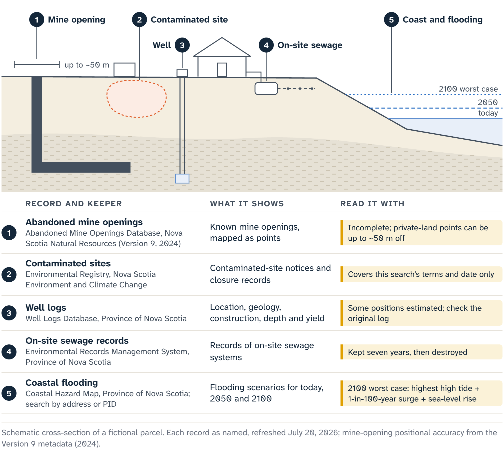
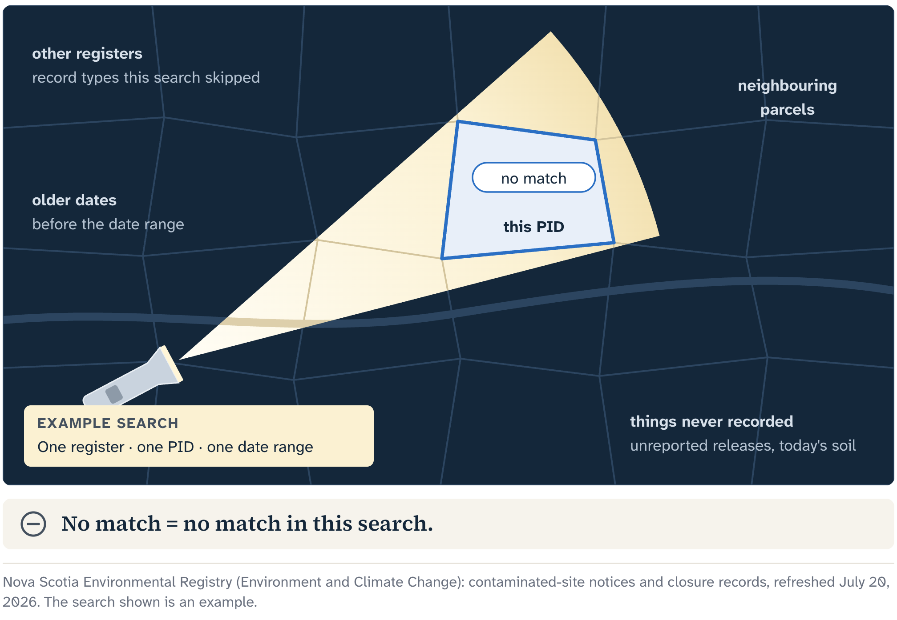

# On, In and Under the Land

Breakwater Lane, another fictional composite, faces a sheltered Nova Scotia cove. A low wooden building sits back from the road. Faded lettering in an old photograph suggests it once housed a small engine-repair workshop. A newer roadside image shows fresh siding, and grass where a fuel tank may once have stood. The map supplies an exact parcel, a coastal setting and a few resource layers.

Sampling, testing and inspection on the ground answer the physical questions: heating oil in the soil, the water in a well, a buried pipe, whether an old system still works. Public records come first and sharpen those questions. This chapter works through them in turn: contaminated-site records, well logs, on-site sewage files, coastal hazard mapping and the abandoned-mine inventory. Each comes from its own record system, shows one kind of evidence and points to the next person to ask.

## Clues from the road

The workshop raises questions about fuel, solvents, waste handling, fill and old spills. A pipe or concrete pad visible from a public place may sharpen one of them. Note each image's date and source, and keep the observation literal: a feature is visible, or a historical record describes a use. Contamination is a finding that takes sampling.

A **contaminated site** is land or water affected by a contaminant in a way that raises environmental assessment, management or remediation questions. Its precise legal and technical meaning comes from the governing framework and qualified professionals. For a researcher before a sale, the term names a condition that records and history may flag and an on-site assessment diagnoses.

## The contaminated-sites search

Nova Scotia's Environmental Registry can include contaminated-site notices and closure records, and the contaminated-sites program warns that spills and historic uses can contaminate soil, water and air. A returned approval, report, spill file or site record may identify an activity, date, location, responsible process or document worth reviewing. Match each one carefully to the parcel and the question: similar civic descriptions, estimated positions, changed parcel boundaries and activity next door can all matter.

An empty search has a smaller job. It shows that this search, of this source, with these terms and method, on this date, found no matching record, and that is all it covers. An unreported release, a use older than the records and today's soil all lie outside it. The registry holds documents made under its own rules and history; sampling describes the ground.

Picture a flashlight in a dark barn. Where the beam shines, it can show a post, a stair or clear floor; the rest of the barn stays dark. A database's beam is systematic, set by its scope, methods and evidence, and some sources light far more than others. Learn what this beam covers before saying anything about what it missed.

::: note
**Breakwater Lane: the first two entries**

Former use and exterior context. A dated photograph appears to show an engine-repair use; public imagery shows a small building and a possible former tank area. Open: any spill or contaminant, where a tank sat, the site's condition today.

Registry search. No parcel-specific contaminated-site record located under the recorded search method and date. Next: widen the search to the address, parcel history, neighbouring sites and prior uses, then ask an environmental professional what lawful pre-purchase assessment is warranted.
:::

## Wells

A **well log** is the recorded account of a well's construction and drilling. It may describe how deep the driller went, the materials met, the casing and a reported yield. The provincial well database gathers many decades of drilling history in one system. Its entries can include location, geology, construction, depth and yield, and together they can reveal patterns and individual records that would otherwise be hard to find. A qualified professional can use them to read regional conditions or to investigate whether a record may relate to the property.

The map point shows where the record places the well, from the location information available when it was made. Some positions are estimates, and the Province warns that the database may be incomplete or inaccurate. A point near the building, or even inside the parcel line, stays an estimate until someone finds the well on the ground; containment only compares two mapped objects. The log itself records a drilling event, and today's well is a question for testing and inspection.

Breakwater Lane returns one well point near the mapped parcel. The record's address resembles an older one linked to the workshop, but the location is estimated and the parcel has since been reconfigured. The log gives a depth and a reported yield. A weak file says, "The property has a well." A careful one says this:

::: note
**Breakwater Lane: the well entry**

One estimated well-log point near the selected parcel, returned under the recorded search, with drilling and construction details. Next: check the original log and confirm on the ground where the well is, whether it belongs to this parcel and who owns it. Testing and inspection then answer its equipment, condition, yield, water quality, legal compliance and ability to serve the property.
:::

## Sewage

A provincial search returns no older on-site sewage record for Breakwater Lane. That can read as a warning that no approved system exists, or as reassurance that all is well. Nova Scotia's environmental records service warns that a record is unlikely for a property more than seven years old. Its process information says these files are kept for seven years and then destroyed. For an older property, an empty search is the expected result either way.

Behind an empty result may be an older system whose records were destroyed, or a system changed, abandoned, shared or missing from that source. The address or parcel may have changed, or a file held elsewhere may answer part of the question. The file keeps all of these open and picks none for convenience.

::: note
**Breakwater Lane: the sewage entry**

No older on-site sewage record returned through the checked provincial request; the source's retention limit explains that result for an older property. Open: whether a system exists, was approved, and is suitable and working now. Next: current municipal and provincial requirements, available property history and a qualified on-site assessment.
:::

## A future shore

The coast and the old mines take the file forward and back in time: to changing water levels and storms, and to mining that may be poorly documented or imprecisely located.

A **hazard map** is a screening map that shows a defined hazard or scenario using stated data and methods. Colour marks where that scenario reaches. Whether damage will occur at a particular coloured place, and whether an uncoloured place is safe from every related hazard, are questions for site work.

Nova Scotia's Coastal Hazard Map can be searched by community, address or Parcel Identification Number (PID), with current, 2050 and 2100 scenarios. Its 2100 worst-case coastal flooding scenario combines the highest high tide, a one-in-one-hundred-year storm surge and projected sea-level rise. That makes it a powerful planning view: it shows that future combination across a large area.

The colour belongs to the selected scenario and the map's current data, model, resolution and guidance. A building's floor elevation comes from a survey; the state of a shoreline protection structure, or floodwater's route through a culvert, from engineering work. Insurers make insurance decisions, and the municipality grants development approval.

Suppose the 2100 scenario shades part of Breakwater Lane's mapped parcel. "The property will flood" overstates it. The file can say this:

::: note
**Breakwater Lane: the coastal entry**

The checked Coastal Hazard Map shows scenario coverage overlapping part of the current mapped parcel under the selected 2100 setting: a long-range screening observation. Next: the exact scenario definition, current topographic and site evidence, the intended building location, the access route, and advice from the appropriate planning and technical professionals.
:::

If the colour stops just outside the parcel line, the nearness still justifies questions about the road, drainage, neighbouring ground, the emergency route and the uncertainty in the screening geometry. The file records it as near. The parcel line is graphical and the scenario is a screen, so "affected" and "safe" wait for site evidence.

## An incomplete past

Nova Scotia's Abandoned Mine Openings inventory is a valuable record of known openings and related information. By its own description it is incomplete: undocumented openings exist, the inventory leaves out surface signs of subsidence, and site conditions may change. Its 2024 metadata adds that positions on private land can carry lower confidence and can be off by up to about 50 metres. On a rural map, that distance can cross a road, a parcel line, a building site or a shoreline. A coordinate therefore goes into the file with its positional quality attached. On its own, it sounds more exact than the record is.

If the mine layer returns a known opening just outside Breakwater Lane, the file holds an inventory entry with a stated approximate position and attributes. It raises questions about the documented working, the positional uncertainty, the surrounding geology and any surface evidence. A qualified site assessment answers where the opening lies, how far workings run and whether the property is safe.

An empty query needs more care. "No abandoned mine opening shown" means the checked source returned no displayed opening for the recorded query and map state. The inventory is incomplete and leaves out some signs of hazard, so "no mining hazard" is a bigger claim than that result can carry. It does narrow one specific concern: that search returned no known inventory point. Recorded with its limit, that is useful evidence.

## Found, empty or failed

Every search ends in one of three states, and the file keeps them apart:

- Found: a feature or scenario returned under the recorded conditions. Keep the source, date, geometry, attributes, coverage limits, positional quality and next question.
- Empty: the query finished and returned nothing. Keep the source, date, settings, completeness limits and the one narrow concern it checked.
- Failed: a service error, loading timeout, hidden layer or wrong selection left no completed result. Record the failure, retry or go straight to the authoritative source, and draw no conclusion from it.

::: {.rail label="Try it"}
You come back to Breakwater Lane's file after a week away. What you remember is blue coastal shading near an old workshop. What do you recover before using either result?

**Answer:** The smaller details. Which scenario was selected, and what did its guidance say the colour represents? Did the mine query return a feature, return none, or fail? What limitation travels with each result? Which property-specific question comes next?
:::

## What the file can carry

A quick read of the three record searches gives "no", "yes" and "no", a false symmetry. Classified, the whole file says much more:

::: note
**Breakwater Lane: environmental summary**

- Former workshop use: a positive clue that widens the environmental inquiry.
- Contaminated-site search: a bounded negative, limited by reporting and by the recorded search.
- Well log: a positive record whose parcel link, mapped position and present condition need confirming.
- Sewage search: a negative whose meaning rests on the source's retention limit.
- Coastal map: the selected 2100 scenario overlaps part of the mapped parcel.
- Mine inventory: the query result, recorded with the inventory's completeness and positional limits.

Each open item goes to the lawful inspection, sampling, surveying, engineering, planning, insurance or legal advice that answers it.
:::

That is what environmental research before a sale can responsibly do: light part of the yard, and say which part. Whether to buy stays with the bidder.

::: careful
A tax-sale listing gives no right to enter the land. Before the sale, research stays on public land or where you have permission, and the file stays an exterior file. Whatever physical uncertainty remains goes into the bid decision as uncertainty. It may govern that decision when the intended use can't carry the remaining risk, when lawful investigation is unavailable before bidding, or when the professional answers would come after the deadline.
:::

Each source earns its place inside its limit, and the mistake is asking any one beam to light the whole parcel. Breakwater Lane remains unseen in important ways, and careful research has made those parts specific enough to route, investigate, price where appropriate, or refuse. The map becomes safer the moment its silence stops being read as reassurance.

::: source
- Nova Scotia Environment and Climate Change: Environmental Registry and Contaminated Sites pages, refreshed 20 July 2026.
- Nova Scotia Well Logs Database, user manual and georeferencing notes, refreshed 20 July 2026.
- Nova Scotia Environmental Records Management System page and Environmental Registry process information sheet (on-site sewage record retention), refreshed 20 July 2026.
- Nova Scotia Coastal Hazard Map User Guide, refreshed 20 July 2026.
- Nova Scotia Natural Resources, Abandoned Mine Openings Database description and DP ME 10, Version 9 metadata, 2024, refreshed 20 July 2026.
- Cape Breton Regional Municipality, Tax Sales page and its frequently asked questions (entry to listed properties), refreshed 20 July 2026.
:::
