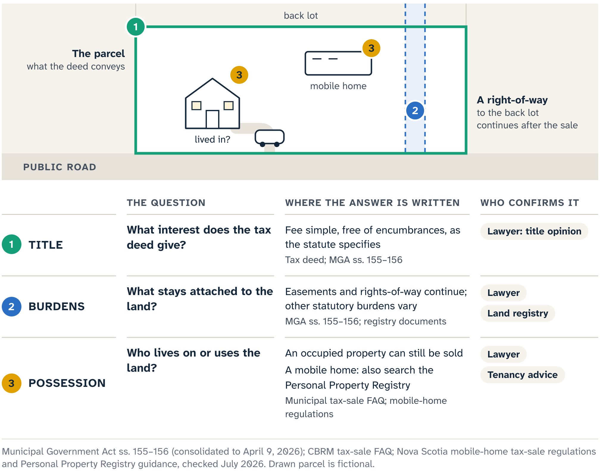
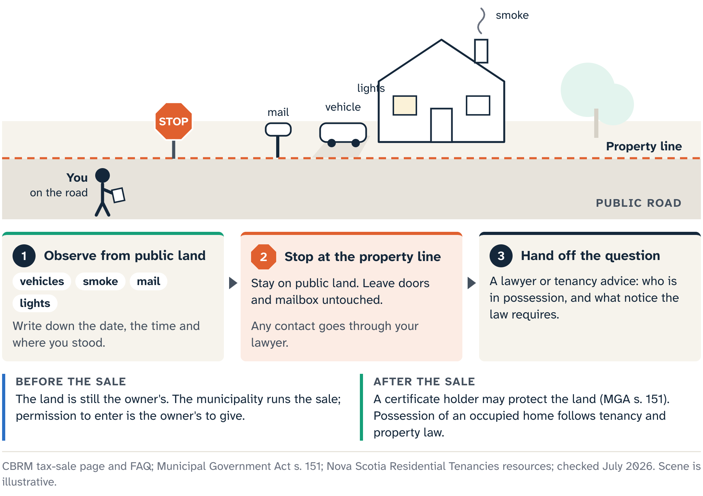

# Title, Burdens and the People on the Land

Before Chapter 9 returns to setting a bid, this chapter jumps ahead to a finished case to show what a deed would change and what it would leave for later.

Meet Foundry Street, a fictional composite: a small apartment building at the last stage of its tax sale. The redemption question has been resolved, the municipal fee has been paid and a tax deed has been registered. A search of the correct Parcel Identification Number (PID) now has a new document at its centre. The deed changes the legal relationship to the land. Three questions still need separate answers: what interest the deed gives, which burdens and benefits continue, and who is in possession.

## What the deed gives

Under the Municipal Government Act, the tax deed is evidence that the statutory sale provisions were followed. The Act says the deed vests the land in the grantee in **fee simple**, the broad form of private ownership people ordinarily mean when they speak of owning land. The phrase names the legal interest conveyed. The building's condition, the people inside, development plans and the surveyed boundary are questions for an inspector, the possession process, a planner and a surveyor.

The Act adds that the deed vests the land free and discharged from all **encumbrances**: claims, interests, charges or burdens that can affect title to land. That powerful language has a specific title job. Read it with the rest of the statute, any court order, the deed itself and the property record.

## Burdens and benefits that stay with the land

Foundry Street's older parcel register shows a mortgage, a judgment and a registered right-of-way serving the house behind it. A hurried summary would say the deed erased everything. The statute says otherwise. An easement or right-of-way that benefits the land being sold passes with the land. One that burdens the land being sold continues: the Act provides that the sale leaves that relationship unaffected.

This is Chapter 6's access lesson from the other side. There, you asked whether a route gave the tax-sale parcel a legal way out. Here, Foundry Street may be the route another parcel relies on, and the statute carries both sides of that relationship through the sale.

So the title file needs more than the reassuring phrase "free of encumbrances." It needs the exact deed, the current parcel register, the instruments behind the relevant entries, the legal description, and a lawyer's reading of how the governing provisions apply to this parcel. For a continuing right-of-way, add its route, purpose, width, parties, maintenance language and any other terms in the source instruments. A driveway line in an aerial photo is a prompt to go and find those terms.

## Court orders and surplus money

A municipal treasurer may also apply to a court for findings about tax arrears and for an order addressing the interests the deed will convey, the interests it will remain subject to, notice, and the manner of sale. A sale on that route takes its legal effect from the statute and the order itself, including any exceptions, exclusions or partial interests the order sets out.

::: note
**Foundry Street file: court order.** Confirm whether the sale proceeded under a court order. If it did, obtain the order and have counsel identify the conveyed interest, every stated exception or exclusion, the redemption treatment, and how the order, deed, parcel register and source instruments relate.
:::

Money is a separate question. A prior interest holder may have a statutory route to claim a share of the tax-sale surplus proceeds. That possible claim follows the money and is not automatically a continuing burden on the land. Chapter 12 traces it.

## Why "clear title" is the wrong shorthand

A municipality may describe the statutory deed process, while current municipal guidance also warns bidders that clear title is not guaranteed. The two fit together: the statute gives a qualifying deed its legal effect, and the warning keeps an auction page from promising more. The bidder and the bidder's lawyer handle the rest: a title opinion on this property, a search for every factual problem, possession, and whether the interest is readily insurable or marketable for a particular transaction.

A Nova Scotia property lawyer working from the file states what "fee simple" and "free of encumbrances" mean for this property. Beyond the court order and the rights-of-way, that review asks:

- Which statute governs this municipality: the Municipal Government Act or, in Halifax, its Charter?
- Does the legal description match the land you researched?
- Do the documents show an exception, exclusion, partial interest, boundary issue or other qualification?
- Is another statute or property-specific record relevant?

::: {.rail label="Try it"}
After the tax deed, which Foundry Street register entry does the statute itself keep in place? Where might a former interest holder look for money?

**Answer:** The right-of-way serving the house behind, which continues as the Act specifies. A former interest holder may have a route to surplus money (Chapter 12) in place of a surviving claim against the parcel. For the mortgage and the judgment, ask the lawyer reading the deed, the register and any court order.
:::

## The people on the land

Foundry Street is occupied. Lights are on in two windows, a vehicle moves between parking spaces and mail keeps arriving. The deed has changed; the people inside are still there.

From the street, who is inside stays open: a former owner, a tenant, a family member, a guest, or someone whose situation fits no quick label. A parked vehicle and a curtained window are observations. Tenancy, trespass and abandonment are legal conclusions, and even a conversation at the door would give an untrained purchaser only part of the facts behind them.

Cape Breton Regional Municipality (CBRM) gives the working example. Its current guidance says occupied properties can be sold, and that the municipality does not remove residents or provide access. Other municipalities set their own terms in their current materials. Everywhere, possession follows its own lawful process, separate from the deed.

The outcome most buyers picture is **vacant possession**: the buyer can lawfully take possession, and no other person remains entitled to occupy the property. Whether and how that can happen depends on the facts and the applicable law. "Immediate deed" describes redemption timing. A paid balance, and a sale advertisement with no tenant named, leave the possession question open.

Title and possession are like a coat-check ticket and the coat in your hand. The ticket is evidence of entitlement; the coat is control, and a strong ticket still leaves the coat on the rack until it is lawfully handed over. The comparison ends there, because a home brings tenancies, court remedies and human safety into play.

::: careful
Before the sale, observe a property that looks occupied only from a public road or other public land, and note the date and what you saw. At every stage, use no self-help. Changing locks, interrupting utilities, moving belongings or demanding rent or departure at the door can harm people's rights and safety, destroy evidence about the occupancy arrangement and make a hard legal problem worse. Take possession questions to a lawyer, with tenancy advice where it applies, before anyone makes contact with the occupants.
:::

Behind that handoff, counsel may need to determine who is present, what documents or agreements exist, whether residential-tenancy law applies, what notices or proceedings are legally required, and how access can be obtained. The facts may point to different processes for an owner who remains, a tenant, an apparently empty unit that still holds goods, or an active dispute. Choosing among them is counsel's work.

The same care applies during redemption. Chapter 3 described the certificate holder's limited statutory powers and duties, including protecting the property, avoiding injury and collecting rent in the circumstances the statute describes. Those duties make the holder responsible for the property, and the current document and legal stage still set the holder's job.

Goods are their own branch. A room that looks unused may still hold someone's furniture, records, medicine, tools or personal effects. Nova Scotia's residential-tenancy system has specific resources and forms for tenant property left behind, because "looks abandoned" is not a disposal standard. Establish the facts and the lawful process before anyone treats goods as abandoned.

Before a bid, possession is an input to the decision. The cost and time of the legal work may be unknown, and the interior unverified. Insurance, repairs, security and your intended use may all depend on lawful access, which sits outside the auction materials. A bidder who needs those answers before committing has learned something decisive without going near the door.

## When the home and the land are separate

Now change one fact: the listing involves a manufactured home. The familiar PID appears in the notice, and the map shows a land parcel beneath the symbol. Which asset is being sold is still an open question.

Nova Scotia has specific tax-sale regulations and prescribed forms for mobile homes. The legal file first identifies whether the sale concerns the land, a mobile home, or a combination described by the controlling documents. An unaffixed home can also raise personal-property questions. Security interests in personal property, including mobile and manufactured homes, are searched in Nova Scotia's Personal Property Registry, a separate system from the land registry. A clean PID search leaves that search still to do.

Location adds a third record family. A manufactured home may sit on land someone else owns, in a land-lease community. Nova Scotia's Residential Tenancies framework applies to those communities, with rules about the space, the tenancy relationship and the sale of a home that stays there. Ownership of the home, ownership of the ground, the right to keep the home on the space and any registered personal-property security are four distinct questions.

::: note
**Harbour Park, a fictional composite.** The municipal notice uses a mobile home identifier and a civic location. The map selects the underlying land PID. A roadside view shows a manufactured home on a serviced pad. Still open: whether home and land share an owner, whether the home is affixed to the land, whether the pad agreement transfers, whether a personal-property lien exists, and whether the home can stay where it sits after a sale.

**File note:** Asset identity unresolved. Confirm from the current municipal notice, the prescribed sale documents, land and mobile-home records, and counsel whether the sale concerns the home, the land or both. Search the personal-property system for the home and determine whether a land-lease relationship applies. A PID-only conclusion is unsupported.
:::

That note feels slower than selecting the parcel and reading the aerial. It is faster than discovering after payment that the mapped ground and the visible home belong to different legal files.

## Four questions before a bid

Foundry Street and Harbour Park now share one set of questions. What do you own? What burdens or benefits it? Who is there, and with what status? If a mobile home is involved, what exactly is the asset, and which registry or tenancy system governs each part?

Each question needs a supportable answer or an explicit stop condition before a bid, and an unfavourable answer still counts. Title counsel interprets the deed and the land interests, property and tenancy counsel identifies the lawful possession route, and the municipality clarifies its current sale documents and event terms.

Keeping these questions apart protects the accuracy of the file and the people whose lives carry on when the paperwork changes. Chapter 9 now goes back to the bid itself, where these open questions become costs and stop conditions. Foundry Street returns in Chapter 12, when the story reaches the deed in order.

::: source
- Municipal Government Act (Nova Scotia), consolidated to 9 April 2026: s. 139A (court-directed sale), ss. 146–147 (surplus proceeds), s. 151 (certificate holder's powers and duties), ss. 155–156 (tax deed and its effect, including continuing easements and rights-of-way).
- Halifax Regional Municipality Charter, consolidated to 1 May 2026: ss. 154, 161–162, 166 and 170–171 (parallel provisions).
- Selling Mobile Homes at Tax Sale Definitions Regulations and Forms (Nova Scotia), refreshed 20 July 2026.
- Nova Scotia Personal Property Registry; Residential Tenancies guidance for tenants and landlords, on ending a tenancy, and on land-lease communities; all refreshed 20 July 2026.
- Cape Breton Regional Municipality, Tax Sales page and FAQ (occupied properties, residents, access and entry before the sale), refreshed 20 July 2026.
:::
