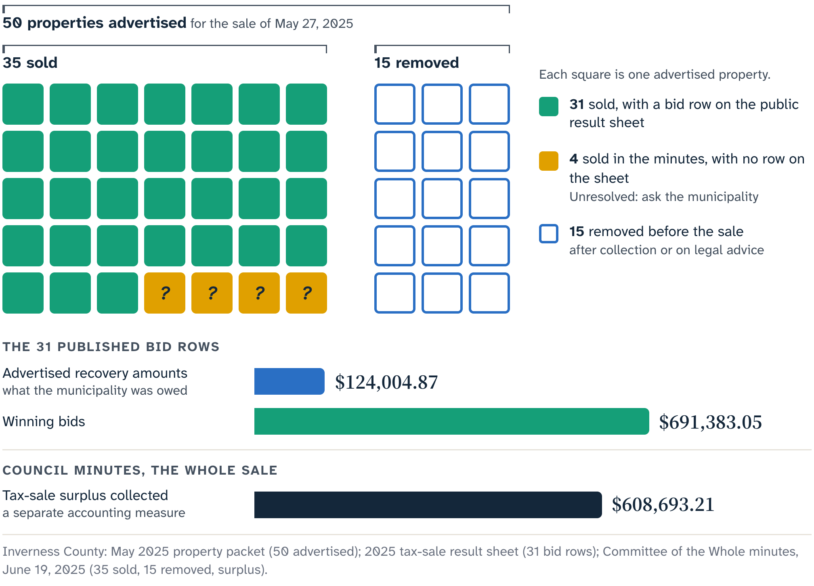
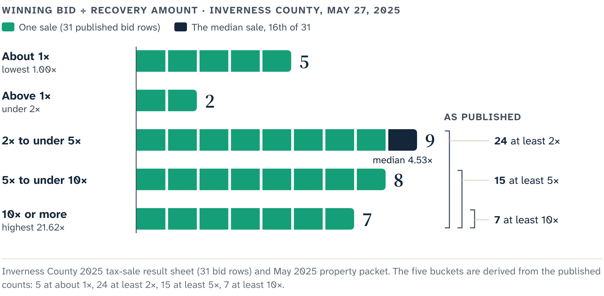
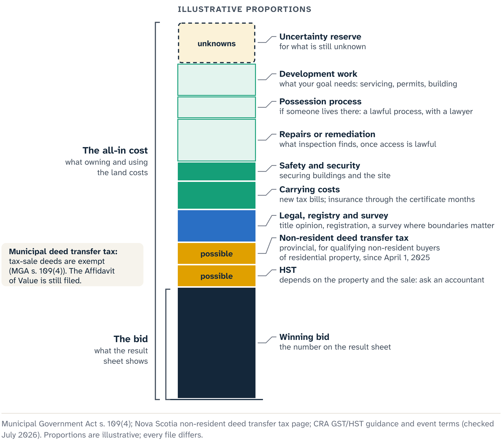
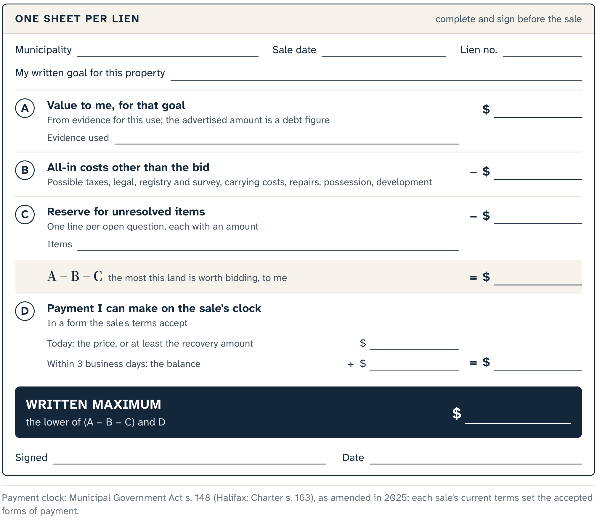

# The Number You Decide Before the Room

A tax-sale result sheet can look like a list of answers. It sets a recovery amount beside a winning bid, sometimes beside an assessment, and invites you to measure the gap. A small first number and a large second one can feel like proof that bidders found hidden value.

The sheet records competition at one event. What the bidders knew, what the property needed, whether the land was later redeemed and how things turned out for the winner all live in other records.

## What a result sheet shows

The numbers in this section are past results. They describe past events and are not a forecast or a valuation.

Inverness County's May 2025 sale shows why you count before you calculate. The municipality advertised 50 properties. Council minutes from June 2025 report that 35 sold and 15 were removed before the sale after collection or legal advice. The public result sheet has 31 bid rows. The four-sale gap is unresolved, so keep all three counts: calling the 31-row sheet "all sales" changes the source.

Across those 31 rows, the median winning bid was 4.53 times the advertised recovery amount, and bids ranged from about the recovery amount to more than 21 times it. In that dated sample, competition often went well past the municipal recovery number.

The minutes also report $608,693.21 in tax-sale surplus. Subtracting the recovery amounts from the bids in the 31 public rows gives a different total, because it covers a different set of rows and surplus is the municipality's own accounting measure. Keep both, each with its source.

The Cape Breton Regional Municipality (CBRM) result sheet for March 2026 makes a useful contrast. Twenty-four recorded sales show both a minimum and a winning bid. Their median ratio was 3.17, and they ranged from exactly the minimum to more than 42 times it. Eight sold at the minimum; nine reached at least five times it.

That mix matters more than any spectacular row. Some rows stopped at the starting amount and others climbed far past it. The cause could be the parcels, the bidders' research, mistaken identity, appetite for risk, intended use or the people who happened to attend, and the sheet gives no way to tell which.

Richmond County's June 2026 table has three sold rows, at about 1.33, 6.59 and 6.28 times the listed taxes, interest and charges. Three rows are enough to show variation within one event and far too few to support a municipal price rule.

For the wider picture, the chart below plots every sold row showing both an advertised amount and a winning bid in NS Marks The Spot's catalogue of official municipal results, 2021 to 2026: 277 sales at 25 events in nine municipalities. Each advertised amount is a debt figure, and the winning bids spread across a wide range above it.

Comparisons like this need labels: each sample's municipality, event date, sale format, number of published rows, denominator and known completeness limit. A minimum bid at one event and listed charges at another can play similar roles and still be different fields.

The historical layer in NS Marks The Spot shortens the route to a dated official outcome and keeps its municipality, event, Parcel Identification Number (PID), result label, amount and source link together. A historical parcel you select is a record of that event. An appraisal, comparable sales and your maximum for the next parcel come from other evidence.

The assessment, as Chapter 2 explained, supports the property-tax system. It helps identify the account, its classification and the scale of the municipal record. Calling the gap between a winning bid and an assessment "equity" takes title, condition, access and market evidence that neither number holds.

## Cedar Street and the all-in cost

Take a fictional composite we will call Cedar Street: a building with a four-figure recovery amount and a six-figure assessment. The apparent discount arrives before the file knows whether the building is occupied, insurable, structurally usable or lawfully reachable for the intended work. The questions from Chapters 6 to 8 (access and use, environment, possession) are still there when the price looks small, and now the money depends on them.

That is why **all-in cost** is useful. It is the total you must be ready to spend to reach a defined use: the bid, applicable taxes, professional work, carrying costs, condition work, possession and a reserve for unresolved uncertainty. It starts with a use because "own the parcel" leaves the destination open. A year-round home, a serviced building lot, a woodlot and a long-term hold each need different evidence and different work.

Think of the bid as the tip of an iceberg. The rest of the cost can sit below the waterline. The hidden share varies from parcel to parcel, and each known part gets researched and estimated like any other line.

::: {.rail label="Try it"}
A file holds a recovery amount, an assessment and a winning bid from a past result sheet. Which describes debt recovery, which serves taxation and which records a dated competition? What would any of them need to support a present value?

**Answer:** The recovery amount, the assessment and the old bid, in that order. A present value needs evidence about this property for a stated use (title, access, condition, possession and planning) plus valuation evidence, such as a qualified appraisal when the stakes call for it.
:::

Competition measures how a room behaved. Cedar Street's number is built backward, from a defined use and a supported value, through known costs and open dependencies, to the uncertainty the bidder can safely carry. It is never a multiple of the recovery amount.

## Three groups of cost

Cedar Street's intended use is a modest rehabilitation. Writing it down gives the cost file a destination. The file then tests whether the project is feasible by asking which costs stand between the bid and a building that lawfully and safely serves that use. They fall into three groups.

The first, acquisition and legal work, covers the bid, registration charges, title and deed review, searches, advice about continuing interests and any work needed to understand possession. A survey or boundary opinion belongs here when the project depends on a fact the existing records leave unsettled. Chapter 8's occupied-building question becomes a cost and timing line, priced from advice on the lawful process and left open until that advice arrives. A guessed eviction budget has no place in it.

The second carries the property through time. Insurance may be available only on particular terms, or may stay unresolved until an insurer understands the building and the legal stage. Taxes continue. Security, heat, utilities, weather protection, financing, travel and professional coordination add up while title, redemption, possession, design or approvals are unfinished. The calendar has a price even when no repair crew is working.

The third is the physical work the use requires: building work, water and sewage, access, servicing, environmental assessment, remediation, demolition and permit-dependent work, each entered where evidence supports it. An exterior photograph starts a list of questions; a reliable rehabilitation estimate needs much more. A missing environmental record is a blank, which is different from zero. A visible road leaves the survey and access questions open.

Each group mixes evidence states. Some items can be quoted before the auction. Some can be bounded by a defensible range or allowance. Others resist responsible pricing with the access, time or evidence available. An essential item of that last kind needs a stop condition, and a bigger miscellaneous line only hides it.

An **uncertainty reserve** is money held back for risks real enough to affect the decision and still too open to quote exactly. It works when the bidder can describe the uncertainty, explain why a range is tolerable and survive the bad outcome without giving up the intended use or required obligations.

An unknown foundation repair might support a reserve when exterior and professional evidence give a meaningful range. Unverified legal access for a project that needs road access may remain a no-go. Unknown occupancy costs may resist pricing while the lawful process and its timing are unknown.

::: careful
A reserve covers variation you can bound. It cannot supply a missing legal right or a permission.
:::

::: note
**Cedar Street's arithmetic, kept small.** A $30,000 bid, $40,000 of known non-bid costs and a $20,000 uncertainty reserve make an all-in exposure of $90,000. The structure is the lesson: bid, known costs, reserve.
:::

Real numbers for Cedar Street need property-specific evidence. A new intended use changes the file. So does a lawyer's title finding, an insurer's refusal, a survey result, an environmental opinion or a lawful inspection. The cost stack moves when the evidence moves.

## Taxes and eligibility

Tax questions branch off before the maximum is written. The Municipal Government Act exempts a deed given pursuant to a tax sale from municipal deed transfer tax. That exemption is specific: registration charges, harmonized sales tax (HST), the provincial non-resident deed transfer tax, income-tax consequences and the cost of advice stay in the file as separate lines.

The provincial non-resident deed transfer tax can apply to qualifying non-residents acquiring residential property. For qualifying transfers after March 2025, the Province states a ten percent rate based on the non-resident interest and the higher of the purchase price or the assessed value, subject to the governing definitions and exemptions. A high assessment can therefore set the tax on a low bid. One exemption route covers qualifying individuals who move to Nova Scotia within six months and provide the required proof. Confirm your status and the tax treatment with current provincial guidance and professional advice before the auction.

HST is a separate branch. CBRM's event instructions, checked in July 2026, say HST applies to vacant land and commercially assessed property. A CBRM bidder needs to clarify and fund that rule. Other events need their own answer, and Canada Revenue Agency guidance shows that the treatment of real property can depend on the seller, prior use, the property, the transaction and the purchaser's registration status. Record the event's terms, get tax advice for the specific case, and resist the reading that happens to make the numbers work.

Eligibility comes before price. As of July 2026, the federal prohibition on certain direct or indirect purchases of residential property by non-Canadians is scheduled to run through January 1, 2027. The Act and regulations contain definitions and exceptions, and current guidance discusses geography, vacant land and genuine development. Each needs exact, current review.

::: careful
A bid the auction accepts can still be a purchase the law forbids. Settle eligibility, for the bidder and for the transaction, before the sale.
:::

Four questions now sit in the file:

- Does the municipal tax-sale deed exemption apply to this deed?
- Could the provincial non-resident tax apply to this buyer and this property?
- What is the HST treatment of this particular transaction?
- Is the buyer eligible under current federal, provincial and municipal law?

An open branch puts the file on hold until its effect is confirmed, bounded or made a stop condition. A tax large enough to change the project gets settled before the sale; the three-business-day payment window is too late.

## The written maximum

The maximum starts from a **supported value boundary**: the highest all-in amount the bidder can defend for the stated use, under title, condition and market assumptions written into the file. In plain terms, it is what the land is worth to you for your goal, with the evidence attached. It comes from property-specific valuation evidence, with a qualified appraisal or valuation advice when the stakes or the uncertainty call for it. Without that evidence by the decision deadline, there is no defensible maximum to calculate.

From there, the number is built backward. Known non-bid costs and the uncertainty reserve use up part of the boundary. What remains can become the maximum bid if every essential legal, eligibility, payment and no-go condition is met. If nothing remains, the research has produced a no-bid result.

A **maximum bid** is the written highest amount the bidder is authorized to offer after accounting for the intended use, the supported value boundary, known costs, reserves, taxes and no-go conditions. It is a stopping rule for one bidder's plan, and it predicts nothing about what the property is worth to anyone else.

It also has to be fundable. Under the statutory payment rules, the purchaser makes the required immediate payment and completes any balance within three business days. The current municipal terms set the accepted methods and event details. A written maximum needs ready funds behind it to be a decision you can carry out.

Cedar Street's worksheet is finished before anyone enters the room. It records the intended use, source dates, professional findings, known costs, the reserve, the tax and eligibility branches, payment readiness, the maximum bid and the facts that would cancel the bidder's authority to take part. It has no line for "one more increment because the room is excited."

Now the live auction reaches the written maximum, and another card goes up. The title file holds the same documents. The building is no easier to insure, the occupancy question is still open, and the environmental and access questions stand where they were. The one new fact is that someone else will pay more.

The bidder lowers the card, carrying out the decision the research supported. The winning number in this chapter is the one that still protects you after the room has moved past it.

::: source
- Municipality of the County of Inverness: May 27, 2025 tax-sale property packet; 2025 property-tax results; Committee of the Whole minutes, 19 June 2025 (counts, removals and reported surplus). Checked 20 July 2026.
- Cape Breton Regional Municipality: sold-property results, 10 March 2026 tax sale; Tax Sales page and event instructions (HST). Checked 20 July 2026.
- Municipality of the County of Richmond: Tax Sales page and 12 June 2026 results, checked 20 July 2026.
- NS Marks The Spot: historical layer and catalogue of official municipal tax-sale results, 2021–2026.
- Municipal Government Act (Nova Scotia), consolidated to 9 April 2026: s. 109(4) (municipal deed transfer tax exemption for tax-sale deeds), ss. 141 and 143 (the amount a sale must recover), s. 148 (immediate payment and balance within three business days).
- Province of Nova Scotia, Non-resident Provincial Deed Transfer Tax, checked 20 July 2026.
- Canada Revenue Agency, *Sales of Vacant Land by Individuals* and *Real Property and the GST/HST*, checked 20 July 2026.
- Prohibition on the Purchase of Residential Property by Non-Canadians Act and Regulations; Department of Finance extension notice; Canada Mortgage and Housing Corporation guidance. Checked 20 July 2026.
:::
