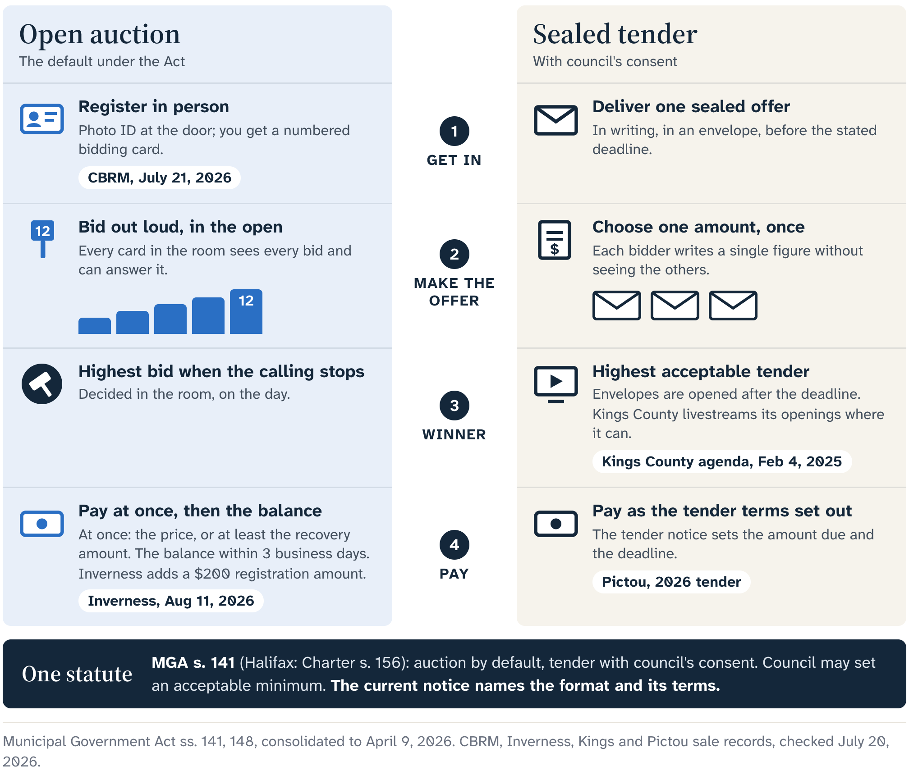
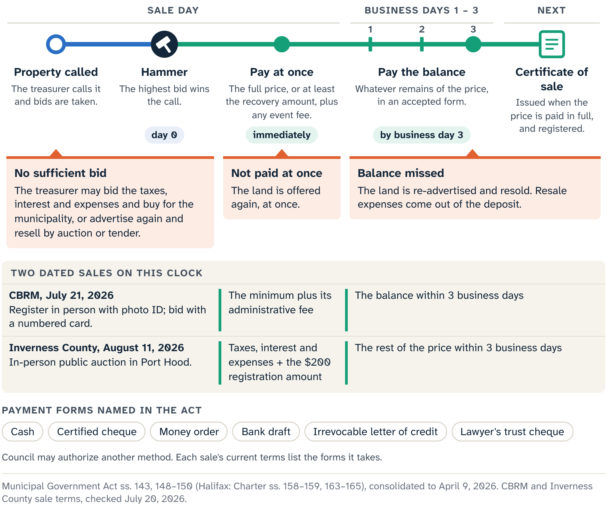

# When the Card Goes Up

The Cedar Street file from Chapter 9 has reached the door of the auction room. Its intended use, open conditions, payment route and maximum bid are all written down, and so is the bidder's authority. A faster heartbeat adds nothing to any of them.

The bidder is a fictional composite we will call Maya.

## Two formats, one decision

Inverness County's terms for its August 2026 sale, checked for this edition, describe a public auction in St. Peter's Parish Hall in Port Hood. Bidders appear in person, follow the event's registration rules and compete while the treasurer calls each property. That is an **open-outcry auction**: a live public process in which participants answer the bids called in the room until no higher acceptable bid is offered. The format puts pressure on display: the next increment, another card rising, the silence that follows.

Cape Breton Regional Municipality (CBRM) shows the mechanics in more detail. For its July 21, 2026 sale, bidders registered with government-issued photo identification and received numbered bidding cards. Other municipalities can publish their own operational details within the same law, so the current notice and terms travel with the bidder.

Outside Halifax, the Municipal Government Act makes public auction the usual route, and the treasurer may, with council's consent, call tenders instead. In a public tender, bidders submit offers by a stated deadline, and the municipality opens and evaluates them under the event's terms. Each offer goes in once, with no live calls to answer. Pictou County's April 2026 sale was a dated sealed-tender example: each bidder chose one amount before the tender left their control, under that event's submission rules.

Annapolis County's records make the case for dating every format label. Its site keeps results from a March 2026 tax sale and later results from a June sale by tender, which shows that a municipality may use more than one statutory route over time. The June tender is closed, and the next Annapolis event will bring its own notice and rules.

Each format has its own temptation. In the room, a bidder may chase a visible rival. At a desk, a bidder may raise a sealed offer to avoid losing by some imagined small margin. Either way, the parcel evidence is the same, and Cedar Street's maximum enters both formats unchanged.

At an auction, Maya knows who is authorized to bid, which card carries that authority and the exact amount at which the card stays down. At a tender, she checks the same ceiling against the submission rules and deadline before the offer goes in. There is no second private number called "what I would have bid if I knew."

## Three questions before the room

Authority takes more than identification or a signed letter.

::: careful
The Municipal Government Act bars these people from buying land at the selling municipality's tax sale, directly or through an agent:

- a council member or employee of that municipality;
- specified village commission members or employees;
- the spouses of those people;
- a company in which one of those people owns or beneficially owns a majority of the outstanding shares.

The statute attaches a penalty and possible loss of office or employment.
:::

That rule covers one statutory group. The federal, tax, corporate-authority and representation questions from Chapter 9 have their own answers, and registering for the event is a separate step again. Maya's pre-event sheet keeps three questions apart:

- Is she legally eligible to acquire this kind of property?
- Does she, or her agent, have documented authority to make this particular bid?
- Has she complied with the event's registration or tender-submission instructions?

Each needs its own yes. Maya and her advisers establish her eligibility and authority, and the municipality administers its event. The researcher's file supplies sources, dates, boundaries and open professional questions; the purchase decision stays with Maya.

::: {.rail label="Try it"}
The registration desk checks Maya's identification and signs her in. Which of her three questions has that answered?

**Answer:** Only the third. The first two need their own evidence on her sheet.
:::

## Auction morning

Auction morning begins with a source refresh. The August Inverness packet lists 45 liens, and its summary and detail pages still need reconciling. More important on the day, any listed account may have been paid, removed or otherwise changed before its turn comes.

The live municipal status controls. A saved PDF, an NS Marks The Spot screenshot and a research worksheet each record what was known at a stated time. If Cedar Street is withdrawn, Maya's authority to bid ends with the announcement, and research about the parcel opens no private route to buy it. Her file keeps its dated records, which show what was known and why she was prepared, and changes its status field. The reason, whether an owner's payment, a municipal deferral or another legal event, goes in only when the authoritative source establishes it.

If the property is called, the worksheet changes jobs. It stops helping Maya find a price and tells her what she already authorized: any bid below the maximum is open to her, and a bid above it is ruled out by her own file. In open outcry that plays out in seconds. The called amount is below Maya's ceiling. Her card rises. Another card raises the price. She answers while the amount stays within her authority. The next call crosses the line. Her card stays down.

This is the Chapter 9 retrieval under noise. Did the higher call create a right of access, improve title, empty the building, shrink the tax costs or put money in the bank? It changed one fact: another participant offered more. Maya's research is the same, so her authority is the same.

## Ready to pay

Payment needs the same rehearsal. Under the Municipal Government Act, the statutory payment forms are cash, certified cheque, money order, bank draft, irrevocable letter of credit and a lawyer's trust cheque. Council may authorize another legal-tender delivery method. Each event's current terms decide which methods the municipality will take and how they must be delivered.

Inverness's August 2026 terms list cash, certified cheque, money order, debit, bank draft and lawyer's trust cheque. Its FAQ says the successful bidder must immediately pay the taxes, interest and expenses for which the property was sold, plus the stated $200 registration amount. Any remaining purchase price is due within three business days.

The **deposit** is the amount paid at once toward the purchase, before the remaining balance is completed. Under the statute's auction rules, the buyer must immediately pay the whole purchase price or a smaller amount equal to the taxes, interest and expenses for which the land was sold. Event charges can sit beside it, like Inverness's $200 amount or the administrative fee CBRM's July 2026 sale added to the minimum. CBRM's sale gave the same three business days for the balance. Use each municipality's current term and amount.

::: careful
Maya has two readiness tests to pass before she bids: the immediate amount on hand in a form the event accepts, and a verified path to the balance within three business days. A plan to ask a lender after the sale is not ready money.
:::

A bank draft is drawn for one fixed amount. A debit card works only if the municipality accepts debit and Maya's bank permits the transaction.

::: note
**Maya's payment sheet for Cedar Street**

- The current event, confirmed on the municipal page.
- The amount required immediately.
- The accepted payment method she holds for it.
- The account or instrument that will complete the balance.
- The three-business-day deadline.
- The person authorized to act.

If any field is still unverified, Maya does not bid on Cedar Street, however affordable the maximum looks.
:::

Tendering moves the moment and keeps the test. Pictou's April 2026 notice required the successful tenderer to pay the bid price in full within three days after notification, with no live hammer and no immediate auction deposit. The format changed what starts the clock and added no room for financing conditions after acceptance, so the payment route had to be ready before the tender went in.

Suppose Maya wins a different fictional parcel within her maximum, and the bank draft she expected falls through that day. Her file may be sound and her price authorized; her payment has still failed. Raising the maximum would solve nothing, and asking the sale to wait would try to change the process after the bid.

Ready means eligible authority, current event status, an intact ceiling, an accepted immediate payment and a verified balance path. When any one fails, keeping the card down is the completed decision.

## When the sale leaves the straight line

The ordinary event runs in a straight line: the property is called, a highest acceptable bid emerges, payment is made and the treasurer moves toward a certificate of sale. The statute also provides for the times that line breaks.

The first break comes before there is a purchaser. If the recovery amount is called and nobody offers enough, the treasurer may bid the taxes, interest and expenses and buy the land for the municipality. The Act also lets a municipality bid and buy through an official or agent for a municipal purpose.

"May" matters: the municipality decides whether to buy. If it declines, it may advertise the property again and later sell it at auction for the best obtainable price, or by highest tender, subject to any acceptable minimum directed by council. The unsold parcel stays inside that municipal, advertised process. CBRM's result legend, as checked in July 2026, says so directly: an unsold property may be purchased only at a future tax sale. Elsewhere, the municipality's own current record names the next step.

The second break comes right after a high bid. If the purchaser fails to make the immediate payment, the treasurer must put the land up for sale again forthwith.

CBRM's July 2026 instructions put that branch in room language: a bid without immediate payment is void, and the property is auctioned again. The next bidder has no automatic claim to the first winning amount; the treasurer reopens the process under the event's rules. Maya, if she is still eligible and prepared, returns to her original ceiling.

The third break comes after the deposit is paid, when the balance misses the three-business-day deadline. The Act sends the land back to advertisement and sale. Resale expenses are deducted from the deposit, and the remaining balance of the deposit is refunded after the resale is held. The amount and timing depend on the actual municipal process, and until then the bidder's money stays tied to a future event.

Tenders follow their own statutory route. The person whose tender is accepted has three business days after notification to pay the tender price. Failure sends the land back toward advertisement and sale, with the statute's treatment of resale expenses and any deposit. A municipal tender notice may also describe how it handles acceptance, rejection or moving to another bid. Read the Act, the council's authority and the exact event terms together, all from the same municipality.

A schedule change calls for the same discipline. The statutory notice states the advertised date, time and place, and the tax-sale provisions reviewed for this book give bidders no general script for a postponement, cancellation or rescheduling dispute. Whether a changed event is proceeding, cancelled or validly rescheduled is a question for the municipality's current notice.

If heavy weather closes the hall or a revised date is posted, Maya goes back to the municipal page and current notice. She confirms the affected properties, time, place, registration and payment terms, and gets legal advice if the change itself is disputed. A social-media post, an old advertisement or another bidder's memory can point her to the source; the current notice is the source.

A completed payment starts a new clock. Cedar Street is in the redeemable branch. If Maya stays within her authority, satisfies the event terms and pays the purchase money, the treasurer gives a certificate of sale. That opens the certificate-holder months of Chapter 11, while redemption is still possible and the deed is further off.

To someone who studied a parcel and missed the first call, the other outcomes can sound like opportunities. Each is a state change with a name: withdrawn, no sufficient bidder, municipal purchase, immediate re-offer, later re-advertisement or verified event change. Each sends Maya back to the current municipal source, the limits of her evidence file and the maximum she wrote down before she came.

::: source
- Municipal Government Act (Nova Scotia), consolidated to 9 April 2026: s. 141 (auction or tender, council consent and acceptable minimum), s. 142(2A) (notice states the date, time and place), s. 143 (no sufficient bid, municipal purchase and resale), s. 144 (people prohibited from buying), ss. 148–149 (payment forms, immediate payment, three-business-day balance, failed payment and resale).
- Halifax Regional Municipality Charter, consolidated to 1 May 2026: ss. 156–159 and 163–164 (the parallel Halifax provisions).
- Municipality of the County of Inverness, Property Tax Sales page and December 2025 FAQ, refreshed 20 July 2026; tax sale property packet for 11 August 2026 (published 16 July 2026, retrieved 19 July 2026).
- Cape Breton Regional Municipality, Tax Sales page: instructions for the 21 July 2026 sale, FAQ and result legend, checked 20 July 2026.
- Municipality of the County of Pictou, 2026-01 sealed-tender advertisement (revised 10 April 2026), checked 20 July 2026.
- Municipality of the County of Annapolis, Tax Sale page with the 5 March 2026 sale results and 8 June 2026 tender results, checked 20 July 2026.
:::
