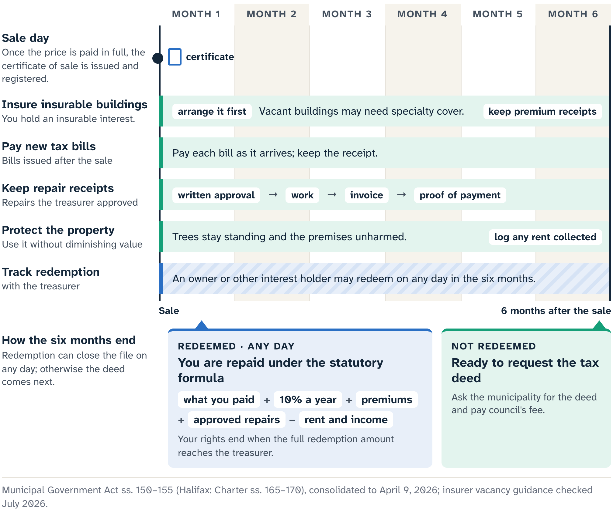

# The Certificate-Holder Months

Maya, the bidder from Chapter 10, leaves the Cedar Street sale with the purchase money paid in full. The treasurer gives her a certificate of sale describing the land and the price, and registers a copy. The treasurer also sends out the copies and redemption notice the statute requires. The auction room is finished. A calendar has begun.

Cedar Street is redeemable. For six months after the sale, the owner or another person with a qualifying interest may redeem it. If nobody does, a tax deed may follow. Until then Maya holds a middle stage, with real responsibilities, conditional rights and an ending that may return the property to someone else.

## What the certificate asks of you

Nova Scotia's Municipal Government Act gives a certificate holder the owner-like powers needed to protect the land. The holder may collect rents due or becoming due, and may use the land without diminishing its value.

Day to day, the months come down to five jobs:

- protect the property against immediate loss;
- insure the buildings, if they are insurable;
- pay the new tax bills when due;
- document every approval, invoice, receipt and payment;
- track income from the land, and the redemption status with the treasurer.

The Act also forbids cutting trees, injuring the premises, or knowingly allowing anyone else to do so.

## Protection or development?

Those powers mark out a narrow lane. A leaking opening may need protection before the next rain; a full redesign for Maya's planned rehabilitation can wait. Cutting mature trees for a future view falls outside the lane, and so does damage passed off as cleanup. The certificate months carry the property through uncertainty, and the construction season comes later, if at all.

Purpose and scale tell protection from development. Work that stops an immediate loss is protective; work that changes the property for a future use is development. Even protective work depends on entry, occupancy, tenancy, safety, permits, contractor authority and the building's exact condition. When any of those is unsettled, the next call goes to the municipality, a lawyer, the insurer or the right professional.

## People, possession and safety

Cedar Street appears vacant from the public road, and "appears" stays in the file. Curtains, vehicles, utilities, stored goods and a quiet building are clues. Lawful vacancy is a legal question.

::: careful
Paying the purchase money does not bring vacant possession, and the municipality does not remove residents or provide access. Maya forces no entry, changes no locks, confronts no one and has no one remove belongings. She asks her lawyer how the certificate's powers fit the possession facts, and records the answer before any physical step.
:::

Safety runs beside legal authority. A damaged roof, an unstable porch, exposed wiring, mould, fuel, animals or an unknown occupant can turn a minor check into an emergency. The certificate gives Maya none of the authority of a building inspector, electrician, environmental professional or peace officer. Urgent threats go to the emergency or municipal authority, and qualified people, using lawful access, scope any non-urgent condition work.

## The operating file

Maya's file opens on sale day.

::: note
**Maya's operating file.** The registered certificate and the sale date. The redemption deadline. The municipal contact and the property-tax account instructions. Possession advice. Insurer communications. Photographs or reports obtained lawfully. Approvals, invoices and receipts. Rent and other income records.
:::

Every item carries a date and a source. Together they explain what Maya knew, which authority she relied on, what she did and what money moved.

## New tax bills

New tax bills matter from the first month. The redemption formula can include taxes levied after the sale and related interest, which is no reason to leave the bills for someone else. Maya confirms where notices will go, how the account is tracked during the certificate period and what must be paid when due. A missed notice can cause a practical problem even when the formula would later count that tax.

## Insurance

The Act deems Maya to have an **insurable interest** in the land: a legally recognized stake that lets her seek insurance against a loss during this conditional stage. The Act also requires her to insure buildings that are insurable, but it cannot make an insurer say yes. Acceptance, coverage and premium are the insurer's decisions.

Vacancy changes the conversation. Canadian insurer materials describe vacant buildings as a risk that ordinary home coverage may stop handling, and one that may need special vacancy or non-standard underwriting. That is market practice; a specific insurer decides whether this building and Maya's interest qualify.

Maya's inquiry states the awkward facts plainly: the certificate stage, the redemption period, the possession information, the known condition, her planned protective measures and any access limits. She asks:

- Will you cover my exact interest?
- Which risks are included, and which are excluded?
- What inspections or safeguards do you require?
- When would coverage begin, and how would a redemption or a later deed affect it?

The first underwriter declines. Maya dates the refusal and files it with her questions in her cost and risk file. One company's decision leaves open whether the building is insurable under the Act, so she keeps looking, and takes advice before treating the duty as impossible.

A specialty broker then finds possible coverage, subject to conditions. Maya gets the actual terms and professional advice before counting it as coverage. Her file records each stage by name, from the product webpage and the quote to the bound policy, its effective date, and the perils and activities it covers.

## A repair, start to finish

A qualified exterior assessment finds a loose roof covering that could let water in during the next storm. Here "protect the land" can stretch too far, into a replacement roof billed in the hope of adding it to redemption. Maya sends the treasurer a defined scope, the assessment and the cost, and asks for written approval. Before work begins, she also checks the legal, safety, insurance and possession conditions.

The redemption amount may include amounts the purchaser paid for **necessary repairs** to buildings, made with the treasurer's written approval. In this book a necessary repair is protective work, supported by the building's actual condition and approved through that statutory path. Improvements, preferred materials, a faster project and work approved after the invoice arrived all fall outside it.

::: careful
Get the treasurer's written approval before the work starts. Treat any repair made without it as your own cost, however necessary it looked.
:::

The treasurer approves a temporary weatherproofing scope in writing. The contractor does only that scope, through a lawful and safe access arrangement. Maya keeps the approval, assessment report, invoice, proof of payment and dated completion record together. Those papers are the centre of the file: they link an observed risk, a professional scope, a written approval, a lawful way of doing the work and an amount paid. Remove any link and the claim becomes a different question. If the contractor finds a larger defect, the new work goes back through the treasurer, the professional and the insurer.

## Rent and other income

The certificate holder may collect rent, and a payment raises questions of its own: who occupies the building, which tenancy or contract applies, whom to contact and which lawful possession steps exist. Maya takes those to her lawyer and the records. She logs any income by date and amount, because it can reduce what she is repaid on redemption.

## When someone redeems

In month four the treasurer tells Maya that a person with a qualifying interest intends to redeem. The message starts the statutory close-out. The work done so far stays on the record, and there is nothing for Maya to negotiate privately with the person redeeming.

Redemption is built into a redeemable sale. The owner, a mortgage or lien holder, a person with another charge, or anyone else with an interest in the land may redeem within the six months. Maya bought with that possibility in the process, so a redemption says nothing about the quality of her research.

The human side needs the same discipline as the money. A former owner may be trying to keep a home, family land or a business, and an occupant may be someone other than the person paying. Maya can close her file without their private story. Communication stays lawful, necessary and respectful, process questions go through the treasurer and her lawyer, and nobody is threatened with entry, removal or construction work while the legal stage changes.

## The redemption amount

The treasurer determines the redemption amount under the statute. Maya supplies records for the items that depend on her conduct. The amount starts with the sum the purchaser paid. Interest at ten percent a year runs on that total from the sale date to the redemption date.

The amount can also include:

- certain older taxes that the purchase money left unpaid;
- taxes levied after the sale, and related interest;
- the fee to record the discharge;
- qualifying fire-insurance premiums;
- necessary-repair amounts paid with the treasurer's written approval.

Two items come off: any balance left in the tax-sale surplus account for the property, and rent or other income the purchaser earned from the land.

The ten percent sounds like a return. Its legal job is narrower: one part of the formula, for the period between sale and redemption, owed only if someone redeems. The statute makes no promise that anyone will, that the property stays free of loss or that every expense qualifies. Taxes, financing costs, professional fees, uninsured damage and time belong in Chapter 9's all-in cost.

## The purchaser's statement

When a redemption is to take place, the purchaser may be asked for a statement of amounts spent on fire-insurance premiums and on repairs made with the treasurer's written approval. A complete file makes that request routine. Rebuilding months of receipts, emails and income afterwards makes it needlessly hard.

Maya's statement lists amounts spent in those two categories, with the evidence: the weatherproofing approval, scope, invoice and proof of payment, and the policy and premium records. A declined quote, an unpaid estimate, a verbal approval and any broader future roof project stay out. New tax bills stay in the municipal account trail. Rent and other income stay in the offset column, even if already spent. Keeping the categories apart gives the treasurer what the redemption needs. A disputed payment or category goes to the treasurer's official process and to legal advice.

The redemption amount and the purchaser's repayment come from separate sections of the Act, and they can differ line by line. The redemption amount includes municipal tax and recording items. The repayment covers the purchase sum, interest, fire-insurance premiums and approved repairs, less rent or other income from the property. The treasurer administers the whole transaction, and Maya checks what she receives against the official statement.

::: {.rail label="Try it"}
Maya's folder holds a declined insurance quote, a fire-insurance premium receipt, an estimate for a new roof, the approved weatherproofing invoice with proof of payment, and her income log. Which go into the statement the treasurer asks for?

**Answer:** The premium receipt and the approved weatherproofing invoice, each with its evidence. The income log belongs in the offset column. The quote and the estimate stay in her file as history.
:::

## Sale expenses: the Halifax example

Halifax shows how many real administrative and professional steps "sale expenses" can cover. It works under its own parallel Charter, and the July 2026 snapshot of its Administrative Order 18 schedule names local categories for notice, title searches, survey, deed work, registration, closing and redemption administration. That list is Halifax's and can change after this edition; an Inverness redemption follows Inverness's rules. Cedar Street's municipality may use different council-approved fees, forms and procedures, so Maya asks it for the official calculation and its current authority, and keeps Halifax's categories and amounts out of her worksheet.

## The moment rights end

The close-out has a precise legal moment. Maya's interest survives a message that someone plans to redeem, and it survives a part payment. From the time the full redemption amount is paid to the treasurer, the Act says the purchaser ceases to have a right to the land. Maya obtains the municipality's official close-out record as proof, and any planned protective work stops.

Everyone who relied on her certificate authority needs prompt, accurate notice. Her insurer may have its own cancellation or change terms. An approved contractor may need a stop instruction. Any keys, documents or site arrangements lawfully made are handled on legal advice. After her rights end, Maya has no authority to hold the property, demand extra money or enter the premises.

## Closing the file

Maya's final ledger holds the whole trail, from the purchase record and the insurer's refusal to the official redemption calculation, her repayment and the municipality's close-out record. It keeps the human side straight too: no private confrontation, and no story of redemption as defeat.

The outcome is financially finite and legally meaningful. Maya receives the repayment the statute and her evidence support, and the person redeeming keeps the land. Her rehabilitation plan stays on paper, yet her work is complete. She protected what she was authorized to protect, documented what the formula could recognize and stopped when the registered stage ended.

If nobody had redeemed, the file would have moved, after the statutory wait, to a request for the deed. That reopens title, possession, condition and intended-use questions under a new document, as Chapter 12 shows. Here the discharge closes the branch. A lawful ending is the process working.

::: source
- Municipal Government Act (Nova Scotia), consolidated to 9 April 2026: s. 150 (certificate of sale), s. 151 (certificate holder's powers and duties), s. 152 (redemption and the redemption amount), ss. 153–154 (repayment and end of the purchaser's rights), s. 155 (deed).
- Halifax Regional Municipality Charter, consolidated to 1 May 2026: ss. 165–170 (parallel provisions); Halifax Administrative Order 18, Schedule 1 (tax-sale expenses), snapshot July 2026.
- Intact Insurance, vacant-home and non-standard-property pages, checked 20 July 2026.
- Cape Breton Regional Municipality, Tax Sales page, and Nova Scotia Residential Tenancies resources, checked 20 July 2026 (occupied properties).
:::
