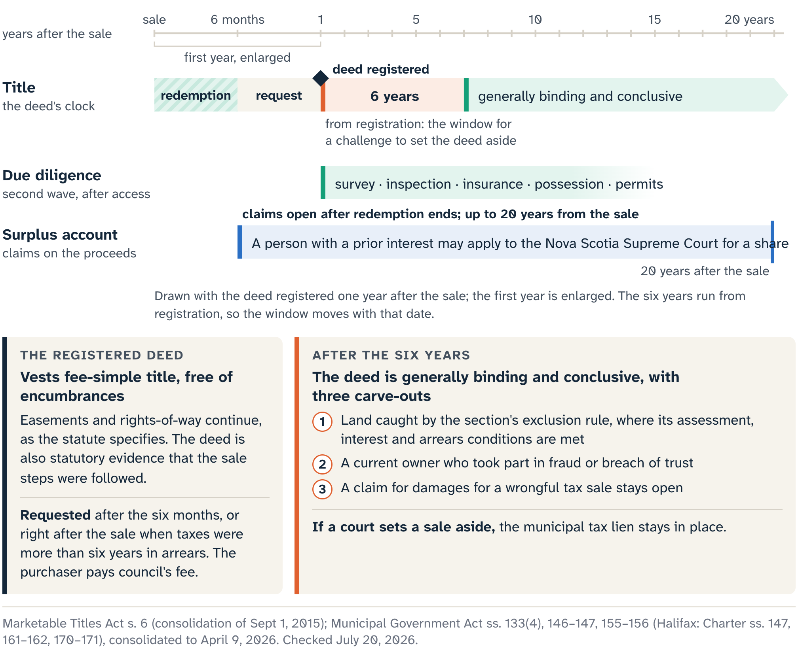
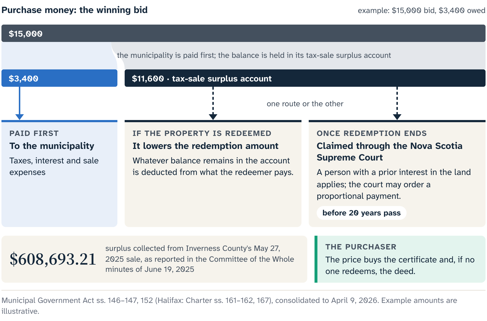

# The Deed Is a Beginning

Chapter 8 jumped ahead to Foundry Street after its tax deed was registered, to separate title from possession before the book turned to bidding money. Now we reach that point in order. Nobody redeemed the property, the applicable wait has ended, and the certificate holder asks the municipality for the deed.

The Municipal Government Act gives two routes to that request. When the taxes were more than six years in arrears at the time of the sale, the purchaser may request the deed after the sale. For a redeemable property that stays unredeemed, the request comes after six months. Either way, the purchaser pays the fee set by council, and the municipality delivers the prescribed deed to the purchaser or as the purchaser directs.

The deed comes on request. Passing the six-month mark makes the request possible, and the purchaser still has to make it. Foundry Street's file confirms that the redemption period expired unredeemed, gets the municipality's current instructions and pays the fee. When the deed arrives, the file checks the land description, grantee, signatures, municipal seal, related sale record and any direction the purchaser gave.

Chapter 8 covered what the deed does to title. The questions now are what the owner does with it and which systems start to rely on it.

## Registering the deed

**Deed registration** is the entry of the deed into Nova Scotia's land-record system. It gives the file a recorded instrument and a registration date that can be searched and tied to the correct parcel. That work sits with the purchaser and their lawyer under the current Land Registry requirements. The file confirms each downstream filing, including any the municipality says it made.

A deed given through a tax sale is exempt from municipal deed-transfer tax under the Municipal Government Act. The provincial deed-transfer service currently says an Affidavit of Value is still required when real property is transferred, even when no municipal deed-transfer tax is payable. The exemption covers that one tax. Harmonized sales tax and the provincial non-resident deed-transfer tax, from Chapter 9, depend on the property and the purchaser. The lawyer and tax adviser apply the current rules, and "tax-free" stays out of the file.

Land Registry guidance lists the fees due when a document is registered, recorded or filed, and those amounts change. The file keeps the current official fee, the receipt, the documents submitted, the registration particulars and the lawyer's confirmation.

## The six-year clock

Registration also starts a legal clock. Under the Marketable Titles Act, a tax deed generally may be set aside only during the six years following its registration. After that, the deed is generally binding and conclusive, subject to the section's own qualifications:

- a land-exclusion rule, which applies when its conditions about the assessment, the interest and the arrears are met;
- an exception where the current owner participated in fraud or breach of trust;
- any cause of action a person may have for damages for a wrongful tax sale, which the section preserves.

The six-month redemption period and this six-year period answer different legal questions.

::: careful
The six years run from the date the tax deed is registered. Auction day, the end of redemption, deed delivery and the first entry into the building are different dates, and none of them starts this clock.

The window is a reason to get title advice now. The purchaser needs the deed, parcel register, legal description, relevant instruments, sale record and a legal opinion when ownership decisions begin. Counsel applies the timing rule and its exceptions to any claimed defect, excluded land, fraud allegation, boundary problem or other dispute.
:::

## What the deed carries forward

Foundry Street's registered right-of-way continues under the rule from Chapter 8, serving the house behind. Before placing materials, fencing or equipment where another parcel may have passage rights, the owner gets the source instrument and learns its route, purpose, maintenance terms and permitted use. The lawyer interprets the registered instruments. A surveyor can relate the legal description and visible occupation to the ground, so work is planned around the real rights and boundaries.

The parcel's own access is the mirror question. A visible driveway or mapped road beside the parcel does not give it legal frontage, a public-road connection or a registered right to pass. Those come from title, plans and a lawyer's reading of them. The deed changes the ownership stage; a missing access instrument is still missing afterwards, and an aerial image still falls short of a survey.

Insurance changes stage too. A policy or binder written for the certificate holder may have terms tied to that conditional interest, the occupancy and the known condition. The new owner gives the insurer and broker the registered-deed information and any updated possession or building facts. The policy and the underwriting response decide whether coverage continues, changes or must be replaced.

## The people in the house

Foundry Street was visibly occupied when Chapter 8 last looked at it.

::: careful
Possession does not arrive with registration. Cape Breton Regional Municipality (CBRM), for example, says it does not remove residents or provide access, and Foundry Street's municipality needs its own current check. The owner proceeds through counsel and the lawful process that fits the facts. Locks, utilities, rent demands and belongings all wait for that process.
:::

Once lawful possession or authorized access is established, plan the first entry as an unknown-condition event. Check the insurance terms, occupant rights, contractor authority, building safety and environmental concerns before anyone treats the premises as an ordinary renovation site. A powerful title document can sit beside an unstable stair, exposed wiring, a fuel leak or stored chemicals.

The owner now holds three records. The registered deed for the correct Parcel Identification Number (PID) states the land interest and supplies the date that starts the Marketable Titles Act period. The title opinion explains the deed and the current land record. Those two form the centre of the title file, and around them sit any continuing easements or rights-of-way, court order, boundary questions, registration requirements and unresolved property-specific qualifications. The possession file shows who is present and which lawful route governs access and control. Physical due diligence begins when those files support the move.

## The second due-diligence wave

The first wave of due diligence helped decide whether to bid. It worked from a distance, under the sale conditions, while ownership and lawful access were unresolved. **Post-deed due diligence** is the planned reopening of the intended-use, condition, cost and permission files once ownership has changed and better evidence is lawfully available. Some questions will stay open; the evidence you can gather has changed.

Foundry Street's pre-bid plan was modest and conditional: stabilize the occupied building, understand the right-of-way and, if the evidence supported it, prepare a small rental rehabilitation. It stayed conditional after registration. The post-deed file starts by restating that use in plain words. Rental rehabilitation touches occupancy, fire safety, building work, insurance, services, financing and local land-use rules. A plan that passed rough screening may fail once those systems return real costs or restrictions.

Municipal letters sharpen part of the picture. CBRM, for example, currently offers two. A zoning confirmation letter confirms the zoning and the applicable land-use by-law provisions identified by planning staff; whether a proposed design will receive permits is a separate decision. A municipal clearance letter reports specified outstanding items in municipal records: building-code orders, by-law orders and fire-code violations. A defect nobody reported or recorded is a job for an inspection. Ask for the letter that matches the question, keep its date and qualifications, and take a difficult answer to the right staff member or professional.

Property Valuation Services Corporation (PVSC) lets the public find assessments by civic address or Assessment Account Number (AAN), with broader searches including by assessment range. Its open data shows assessed and taxable assessed values over several years, and a parcel sheet may carry the dated account and assessment. The assessed value is a mass-appraisal estimate tied to a stated valuation date and to the physical state recorded at a stated condition date. The taxable assessed value may differ, including through the Capped Assessment Program, and transfer-related eligibility can also change.

Foundry Street records the year, value type and source beside each number, and its budget calls the figure an assessment. Market price, condition, repair cost, resale prospects and the maximum bid need evidence built for those jobs. The tax adviser and municipality handle the taxable assessment and rates.

Lawful access now turns pre-bid unknowns into qualified observations. A building professional may find that the roof needs more than the temporary protection imagined during redemption. Electrical, structural, fire or moisture evidence may change the order of work. Service providers can confirm whether a connection exists, whether it works and what restoration would take. An insurer can underwrite the real occupancy and condition.

On the environmental side, provincial guidance explains that contamination can affect soil, water and air. A map layer, a historic image or a neighbouring use can justify a question. A qualified environmental professional answers it from the site's history, the materials observed and the proposed work, and the owner follows the property-specific regulatory route that results. Wells, on-site sewage, coastlines, flood context, mine workings and the other layers from earlier chapters work the same way. Their map symbols are retrieval handles: after the deed, the owner goes back to the current official record, gets an inspection or professional interpretation where needed, and writes down what is still unknown.

Now suppose the evidence changes the economics. The clearance file shows an unresolved order, the building review expands the immediate stabilization work, and the insurer will cover only a tightly controlled vacant-building phase. That is the earlier screen doing its job, leaving room for better evidence to change the next decision.

The project can be narrowed, delayed, stabilized for later work, prepared for a lawful resale, or taken back to advisers for a different route. Ownership owes the pre-bid story no loyalty. It owes responsible treatment of the land, the people connected to it and the evidence now available.

::: note
**Foundry Street's updated decision record**

This record closes the second wave. It states the intended use, the evidence dates, the material unknowns, the professional or municipal handoffs and the next authorized expenditure. It is worth more than a victory photograph, because it shows what the deed has made possible and what is still unsolved.
:::

## The money takes its own road

The deed gives the purchaser title to the land. The sale money and any challenge to the sale follow their own routes.

Sale proceeds first pay the municipality's required amounts. A **tax-sale surplus account** is the municipality's statutory account for what remains. It is a record of money, separate from the question of which interests still burden the land. Had the property been redeemed, the balance would have reduced the redemption price, as Chapter 11 showed.

After the redemption period, a person claiming an interest in land sold for taxes may apply to the Nova Scotia Supreme Court, before twenty years have passed from the sale. The court may order proportional payment from the surplus account.

Elena, a fictional former co-owner whose interest may have attached to the property before the sale, learns that the sale left a balance. She makes no demand of the new deed holder and no claim against the land. She takes the notices, her ownership documents and the sale information to a lawyer.

The route says nothing yet about her standing, evidence, share or result. Her lawyer identifies the parties, proof and court procedure. Her twenty-year limit runs from the sale date; Foundry Street's six-year period runs from registration. Writing both dates in one file keeps the word "deadline" from blurring two unrelated clocks.

::: {.rail label="Try it"}
A file lists four dates: the sale, the end of redemption, deed delivery and deed registration. Which starts the six-month redemption period, the six-year Marketable Titles Act period and the twenty-year limit for a surplus application?

**Answer:** The sale date starts the six months and the twenty years. Registration starts the six years. The end of redemption opens the surplus application, and deed delivery starts none of these clocks.
:::

## When someone challenges the sale

A challenge to the sale travels on another track. A claimant may allege that the sale included land that should have been left out, that a required step failed, or that another statutory ground applies. Those allegations need the complete record and legal advice, and a court may decide them. The six-year limit described earlier, with its exceptions, governs when an action to set aside the deed can be brought.

If a tax sale is set aside, the Municipal Government Act provides that the tax lien is not discharged. A set-aside is no simple rewind to the earlier positions with the municipality's claim gone. Counsel explains the effect of the order, the surviving lien and any related remedy.

Three files stay separate even when they concern the same sale:

- the registered deed and title opinion support the owner's land decisions;
- the municipal accounting and court materials govern a claimant's possible share of the surplus;
- the sale record, the statute and the legal process govern a claimed defect or remedy.

Keeping them apart prevents two opposite errors: a deed holder taking surplus money the statute reserves for another process, and a former interest holder treating a possible claim to proceeds as present possession or control of the land.

Foundry Street ends the chapter with a registered deed, an active title and possession file, and a revised plan built on evidence that was out of reach at the auction. Elena's surplus file runs on its own track, and a contested-sale file, if one appears, goes to counsel. That is why the deed is a beginning: it changes the legal stage and the evidence the owner can gather, and it leaves lawful routes open for people whose claims concern the proceeds or the sale itself.

The method now runs from first notice to post-deed file. The last skill is recognition: know the current stage, open the right evidence record, and know when the map hands the matter to a municipality, registry, surveyor, insurer, tax adviser, environmental professional or lawyer.

::: source
- Municipal Government Act (Nova Scotia), consolidated to 9 April 2026: s. 109(4) (tax-sale deed exempt from municipal deed transfer tax), s. 133(4) (tax lien not discharged when a sale is set aside), ss. 146–147 (proceeds, surplus account and Supreme Court applications), ss. 155–156 (deed request, fee and effect).
- Halifax Regional Municipality Charter, consolidated to 1 May 2026: s. 147(4), ss. 161–162, ss. 170–171 (parallel Halifax provisions).
- Marketable Titles Act (Nova Scotia), standalone consolidation dated 1 September 2015: s. 6 (six-year period to set aside a tax deed, exceptions and preserved damages claims).
- Nova Scotia, Municipal deed transfer and property tax service (Affidavit of Value) and Land Registry fees page, checked 20 July 2026.
- Cape Breton Regional Municipality, Tax Sales page (occupied properties) and Zoning Confirmation and Municipal Clearance page, checked 20 July 2026.
- Property Valuation Services Corporation, Find an Assessment, 2026 assessment-notice guidance and datazONE assessed-value history, checked 20 July 2026.
- Nova Scotia Environment and Climate Change, Environmental Registry and Contaminated Sites pages, checked 20 July 2026.
- Nova Scotia Residential Tenancies, tenant and landlord resources, checked 20 July 2026.
:::
