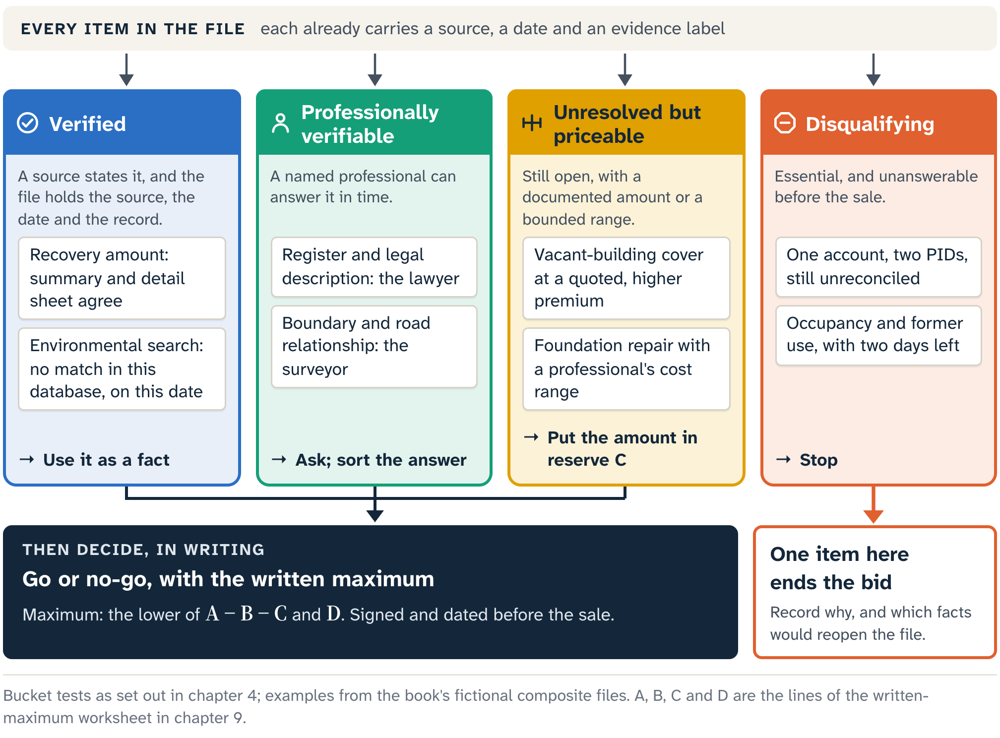
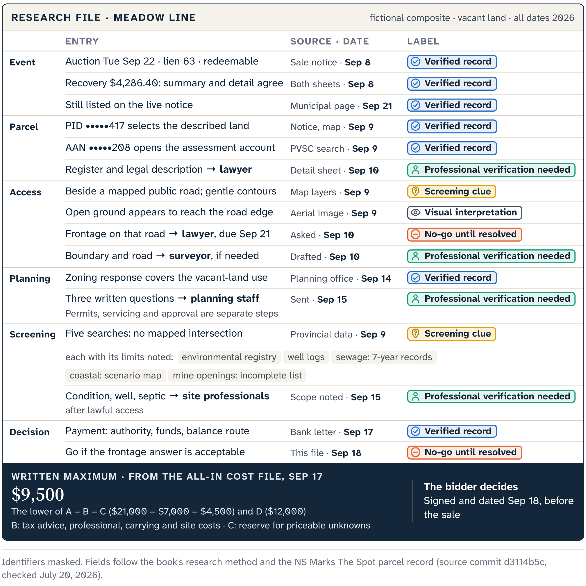

# A File That Knows Its Limits

In Chapter 1, Harbour Road was one fictional row in a strong municipal packet. The packet supplied facts, maps and registry material and left their meaning to the bidder's research. Twelve chapters later, the test is whether that research holds when the facts change.

Three new files arrive, all fictional composites with no live property behind them. Alder Crossing's notice appears to cover two parcels. Union Workshop is a building that appears occupied and may once have been a workshop. Meadow Line is vacant land whose records fit together better than the others. Each file is built the same way: dated notice, exact parcel, bounded context, open questions, and the authority that answers next. The endings differ.

## Sort, label, route, decide

Once a file is built, four moves turn it into a decision. Sort every item into one of Chapter 4's four buckets: verified, professionally verifiable, unresolved but priceable, or disqualifying. Label it with its source, its date and one of the five evidence labels from the same chapter. Route each open question to the person or office that can answer it. Then decide, in writing.

## Alder Crossing: one account, two parcels

Alder Crossing's municipal row lists one account and two Parcel Identification Numbers (PIDs). Searching the stated address returns an authoritative civic point inside the first parcel. The second PID selects a separate shape next door. On the aerial image the first parcel holds a roof, so it looks like the obvious subject.

Before sorting, write one sentence with four parts:

- the verified fact: the dated notice lists one account with two PIDs, and the civic point sits inside one of the two graphical parcel outlines;
- the open question: what interest the municipality intends to sell, and how the PIDs, the account, the legal descriptions and any building relate;
- the next authority: the municipality's current notice or confirmation, and counsel reading the land records;
- the consequence: stop, with both parcels kept in the file, however memorable the roof makes one of them.

The map did its job by finding a parcel to investigate, and the Assessment Account Number (AAN) adds taxation context. The municipal record and the land records settle which registered interests are included. Until they reconcile the two PIDs, the title request, the use analysis and any maximum bid all wait.

Alder Crossing is a complete stop result. The researcher can state what matched, what conflicted, who answers next, and why the records choose the parcel, whatever the aerial image suggests.

## Union Workshop: open questions on a short clock

Union Workshop's notice gives one account and one PID, and the aerial image shows a substantial building. A street-level view of the exterior, taken from a lawful public position, suggests the premises are occupied. Older directories link the address to repair work. The current public environmental search finds no matching contaminated-site notice for the exact parcel.

::: careful
The fictional notice offers no entry and no help removing anyone living there. Where Cape Breton Regional Municipality serves as the public comparison, its guidance expressly declines both; a real event's current terms still need checking. An empty environmental search speaks for that one source on that date.
:::

Each clue gets its own route. Occupancy goes to a lawyer-reviewed possession and tenancy file: who is present, their legal status, and whether vacant possession can be obtained. Former use and current condition go to a property-specific environmental and building review of the soil, water, air, building materials and contents. Planning, fire and building officials report what their records cover, and an insurer responds to the actual use, occupancy and condition.

The assessment gives dated mass-appraisal and taxation context, including the classification shown by the public source, and that classification feeds the tax route. If the event terms say harmonized sales tax (HST) applies to vacant land or commercially assessed property, that is an important instruction for that event. Federal treatment still depends on the seller, the property, its use and the transaction, so the classification is a prompt for transaction-specific tax advice.

Now add the clock. The sale is two days away, no lawful inspection is possible, occupancy is unresolved, and the environmental review needs more time than remains. The researcher resists inventing a reserve big enough to hide the unknowns, and records why they are unpriceable for now and which facts would reopen the file. The bidder owns the decision to stop.

That is a harder kind of completion than Alder Crossing's. One identity conflict can govern a file cleanly; several interacting unknowns can stall one with no single dramatic defect. The research still kept occupancy, the assessment and a clean database screen from becoming false comfort.

::: {.rail label="Try it"}
Union Workshop's environmental search returned no match. Which bucket does that result go in?

**Answer:** Verified, as a search result: this database, on this date, held no matching notice. The soil, water and building are separate items. With two days left and no review possible, they sit in the disqualifying bucket.
:::

## Meadow Line: a file ready for a decision

Meadow Line's records line up, which makes it the most research-ready of the three files. That phrase describes the evidence and nothing more.

::: note
Meadow Line's file, layer by layer, with the route for each open question:

- Identity: the summary entry and detail sheet agree on the recovery amount, the AAN leads to the assessment account, and the PID selects the land the municipal material describes. The lawyer reviews the parcel register and legal description.
- Orientation and access: the parcel sits near community services, and its graphical outline lies beside a mapped public road on gentle contours. The lawyer confirms frontage from the access evidence. A surveyor joins if the boundary or road relationship matters to the plan.
- Planning: a current zoning-confirmation response addresses the stated vacant-land use, identifying current zoning and the provisions that apply. Permits, servicing confirmation and project approval are separate steps. Zone, frontage, well and septic assumptions are written down, with three written questions for municipal planning staff. The municipality answers the exact frontage, lot, intended-use and approval questions.
- Screening: the environmental, well, sewage, coastal and mine searches return no mapped intersection calling for an immediate specialist. Each is listed with its source's coverage and currency limits, and inspection, service and site professionals test what the public record leaves open.
:::

The standard for the whole file is decision-critical: every uncertainty that could change the decision is resolved or given a defensible treatment.

Historical results stay out of the value column. Inverness's records from its May 2025 sale show published bids often exceeding recovery amounts, and its official sources differ on some counts. That is useful evidence about competition and record completeness at that event.

If the essential legal and use questions come back with acceptable answers, Meadow Line moves to an all-in cost file. It holds the intended use, current tax advice, professional, carrying and site costs, and a reserve for the uncertainty that evidence can price. The supported value boundary from Chapter 9, less those costs, gives the written maximum, and the energy of the room leaves it there.

Payment readiness is a separate gate. If the bidder lacks the authority, accepted funds or balance route that the current event terms require, the file is not ready, whatever the spreadsheet says.

So Meadow Line reaches a decision point. The evidence may support taking part under a fixed maximum and a verified payment plan, and the researcher can explain how the file got there. The bidder decides whether to proceed. The file declares no bargain and recommends no bid.

## Three endings

The three files end three ways: a stop on parcel identity, a stop on time, and a bounded file handed to the bidder. Each ending is a record of why, and each is useful, Meadow Line's included if the bidder stops when bidding passes the written maximum. A purchase is one possible ending. A documented decision to stay out can be just as complete.

## The record that survives the event

Then the world moves. A parcel is withdrawn, a bidder pays, an owner redeems, a certificate holder requests a deed, an inspection contradicts the pre-bid screen. A file that holds only a screenshot and a conclusion goes stale or misleading with each change.

The stable core is short: dated municipal notice, exact identifiers, bounded context, visible unknowns, next authority and decision consequence. Refresh the municipal source before acting. Keep the AAN, PID, civic point, graphical boundary and legal description in their separate jobs. Give each map result its source, retrieval date and limitation, and address each unknown to a named professional or public authority. Meadow Line's one-page file has exactly that shape.

Subscription land-record material, such as Property Online pages, stays in the governed working file unless its reuse is authorized, because it is subscriber-only and carries owner details. A public explanation names the question and the need for registry review. The public map stays owner-free and parcel-first.

When the world changes, add a **stage record**, a new dated line in the file. It states the controlling document, the power or duty it creates, its boundary, the next authorized action and the event that will end that stage. Earlier entries stay as dated evidence of what was known. Authority to act comes from the current stage.

If Meadow Line is withdrawn before its row is called, the file records the withdrawal and its municipal source, closes the bid action and keeps the earlier research date. If payment instead produces a certificate in the redeemable branch, the file opens the certificate-holder records. Full payment of the redemption amount to the treasurer ends the purchaser's rights. An unredeemed sale can move to the deed request and a new ownership file when the applicable wait and the municipal process permit it.

The registered deed has real statutory effect on title. Survey, possession, inspection, access and development approval keep their own routes, and the post-deed file replaces screenable unknowns with better, lawfully obtained evidence where it can.

## The map and the people

A better public map follows the same record. It makes the municipal notice easy to find, selects the exact PID, shows dated context, states what each source returned and sends the user to the direct authority. It can show public assessed and taxable assessed values when their year and type are unmistakable. It leaves out property scores, predicted values, invented nearest civic addresses, implied access rights and any hidden default layer that changes what an empty result means.

The same record divides the work. The researcher reconciles published sources, keeps disagreements visible, runs reproducible public screens and writes precise questions. Lawyers, surveyors, public officials and qualified site professionals own their conclusions. The bidder owns the risk tolerance, the financing and the final decision.

## Back in Port Hood

Picture the parish hall in Port Hood again. The treasurer has a list, registered bidders wait, and the people beyond the room still have interests far larger than any row on it. When the first parcel is called, the municipality is there to collect.

What has changed is how you read the row. It is a notice connected to a parcel. The parcel sits in bounded context, its unknowns stay visible, and its questions go to the people authorized to answer them. That record is enough to support a careful decision. It is also enough to explain, in public and without a sales pitch, how tax-sale research in Nova Scotia can be useful.

::: source
- Municipal Government Act (Nova Scotia), consolidated to 9 April 2026: s. 148 (payment), s. 150 (certificate of sale), ss. 152–154 (redemption and the end of the purchaser's rights), ss. 155–156 (deed request and effect).
- Cape Breton Regional Municipality, Tax Sales page and FAQ (occupancy, entry, HST); Canada Revenue Agency, *Real Property and the GST/HST*; both checked 20 July 2026.
- Property Valuation Services Corporation assessment search and assessed-value history; Nova Scotia Environmental Registry and Contaminated Sites pages; checked July 2026.
- Municipality of the County of Inverness, May 2025 tax-sale result sheet and Committee of the Whole minutes of 19 June 2025.
- NS Marks The Spot, source commit d3114b5c, production capture 20 July 2026.
:::
